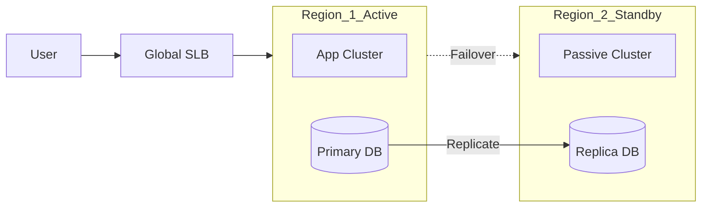

# Disaster Recovery (DR)

Disaster recovery is the set of policies and procedures to enable the recovery or continuation of vital technology infrastructure following a natural or human-induced disaster.

---

## 1. Key Metrics: RTO and RPO

- **RTO (Recovery Time Objective)**: How long can we afford to be down? *Lower is better, but more expensive.*
- **RPO (Recovery Point Objective)**: How much data can we afford to lose? (e.g., "The last 1 hour of transactions"). *Lower means more frequent backups or synchronous replication.*

---

## 2. DR Strategies (Ordered by Cost & Speed)

### A. Backup and Restore
Regularly backing up data to a remote location (e.g., S3).
- **RTO**: Hours/Days.
- **RPO**: Hours (Time of last backup).

### B. Pilot Light
Keeping a minimal version of the system always running in another region (e.g., just the database with live replication).
- **RTO**: Minutes (Time to spin up application servers).
- **RPO**: Seconds/Minutes (Replication lag).

### C. Warm Standby
A scaled-down but fully functional version of the system is always running in another region.
- **RTO**: Seconds/Minutes (Time to scale up and switch DNS).

### D. Multi-Site (Active-Active)
The application runs in two or more regions simultaneously. Traffic is split between them.
- **RTO**: Zero (Real-time failover).
- **RPO**: Zero (If synchronous replication is used).

---

## 3. Database Failover Logic

- **Synchronous Replication**: The Leader waits for a Follower to acknowledge the write before telling the user "Success." (High RPO accuracy, but slower).
- **Asynchronous Replication**: The Leader acknowledges the user immediately and sends data to Followers in the background. (Fast, but risk of losing the last few seconds of data during a crash).

---

## 4. Interview "Senior" Discussion Points

- **The "Split Brain" Problem**: What happens if two nodes both think they are the "Leader" after a network partition? (Answer: **Quorum-based election** using Raft or Paxos).
- **Chaos Testing**: Regularly taking down a data center to verify that your failover logic actually works.
- **DNS Level Failover**: Using health checks on your GSLB (Global Server Load Balancer) to automatically remove a failed region from the rotation.

> **Senior Tip**: Always ask about the "Cost of Downtime" vs the "Cost of DR." Paying for an Active-Active setup for a simple internal tool is bad engineering. Matching the strategy to the business impact is a staff-level trait.
