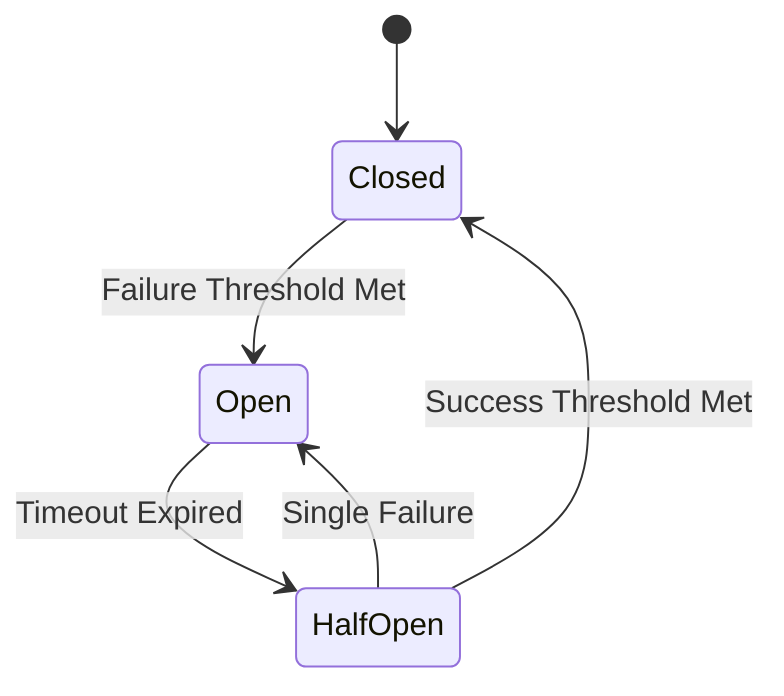

# Operational Excellence: SLA, SLO, and Service Discovery

Designing a system is only 20% of the job; running it reliably is the other 80%. This guide covers the metrics and tools used to maintain healthy systems.

---

## 1. Reliability Metrics (SLA, SLO, SLI)

- **SLI (Service Level Indicator)**: A quantitative measure of some aspect of the service (e.g., Latency, Error Rate, Availability). *Example: "99th percentile latency of /order is 200ms."*
- **SLO (Service Level Objective)**: A target value or range for an SLI. *Example: "99% of requests must be faster than 300ms."*
- **SLA (Service Level Agreement)**: A legal contract with a customer that defines penalties (usually credits) if an SLO is missed.

---

## 2. Service Discovery
In a dynamic environment (like K8s), IP addresses change constantly. How does the API Gateway find the "Inventory Service"?
- **Server-Side Discovery**: The client calls a Load Balancer, which queries a Service Registry (e.g., AWS ALBs).
- **Client-Side Discovery**: The client queries the Service Registry (e.g., **Consul**, **Netflix Eureka**) directly and picks an IP.

---

## 3. Resilience: The Circuit Breaker
If Service A calls Service B and Service B is slow, Service A will eventually run out of threads and crash. The Circuit Breaker stops the bleeding.
1. **Closed**: Normal state. Requests pass through.
2. **Open**: Error threshold (e.g., 50% failures) met. Requests fail immediately with a "Fast Fail" error.
3. **Half-Open**: After a cooldown, allow a few requests. If they succeed, move back to **Closed**.

---

## 4. Observability: The Three Pillars
1. **Metrics**: Aggregated data over time (CPU, RPS).
2. **Logging**: Detailed records of discrete events (User X logged in).
3. **Tracing**: Tracking a single request as it travels through 10 microservices (Zipkin, Jaeger).

---

## 5. Interview "Senior" Discussion Points

- **Error Budgets**: SLOs define an "Error Budget." If you have 99.9% availability, you can afford 43 minutes of downtime per month. If you haven't used it, you can take more risks (like risky deployments).
- **Chaos Engineering**: Intentionally breaking things in production (Netflix's Chaos Monkey) to ensure your HA systems actually work.
- **Log Aggregation**: Handling TBs of logs via the **ELK Stack** (Elasticsearch, Logstash, Kibana) or Grafana Loki.

> **Senior Tip**: Mention **Mean Time To Recovery (MTTR)** vs. **Mean Time Between Failures (MTBF)**. A senior engineer focuses on reducing MTTR (how fast can we fix it?) as much as preventing failure.
