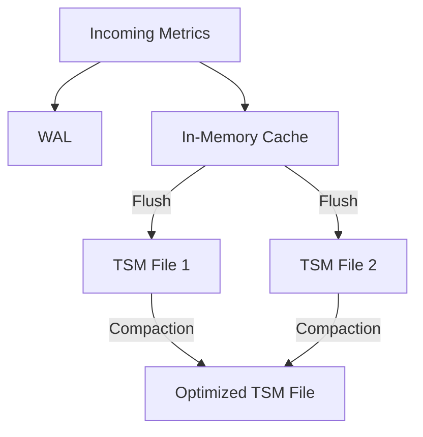
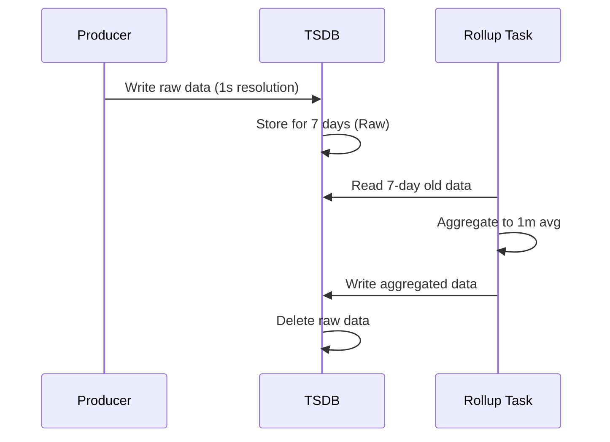

# Time Series Databases: High-Ingest Persistence & Retrieval

Time Series Databases (TSDB) are specialized for data that is indexed by time. Traditional RDBMS struggle with the high-ingest, append-only nature of metrics and telemetry.

---

## 1. The TSDB Storage Model: LSM-Trees & TSM

TSDBs typically use a variant of the **LSM-Tree** because seek times on disk are the bottleneck for high-velocity writes.

- **WAL (Write Ahead Log)**: Ensures durability for incoming points.
- **Cache (Memtable)**: In-memory sorted buffer.
- **TSM (Time Structured Merge Tree)**: A collection of read-only files on disk where data is organized by series and time.

---

## 2. Compression: Making Infinity Scale

Since TSDBs store billions of points, compression is mandatory.
- **Delta-of-Delta Encoding**: Instead of storing the full timestamp, store the difference from the previous point.
- **Gorilla Compression (XOR)**: Compressing floating-point values by XORing them with the previous value and only storing the non-zero bits.
- **Run-Length Encoding (RLE)**: Efficient for repeated values.

---

## 3. Dealing with High Cardinality

**Cardinality** refers to the number of unique combinations of tags.
- *Good*: `host_id` (thousands).
- *Bad*: `user_id` or `session_id` (millions).
High cardinality causes index bloat and slows down queries.

---

## 4. Retention & Downsampling

- **TTL (Time to Live)**: Automatically expire old raw data.
- **Rollups (Downsampling)**: Aggregate 10-second data into 1-minute averages to save space while maintaining historical trends.

---

## 5. Summary: When to use TSDB?

- **Use it if**: You have high-velocity append-only data (Monitoring, IoT, Financial ticks).
- **Skip it if**: You need complex joins or frequent updates to existing data.

> **Senior Tip**: In an interview, if the problem involves "Monitoring 1M servers," mention **VictoriaMetrics** or **InfluxDB** and explain that you'd use a **Pull-based** (Prometheus) or **Push-based** (Telegraf) architecture based on the reliability of the network.
