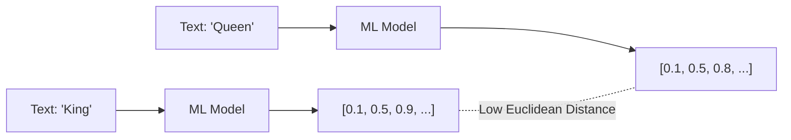
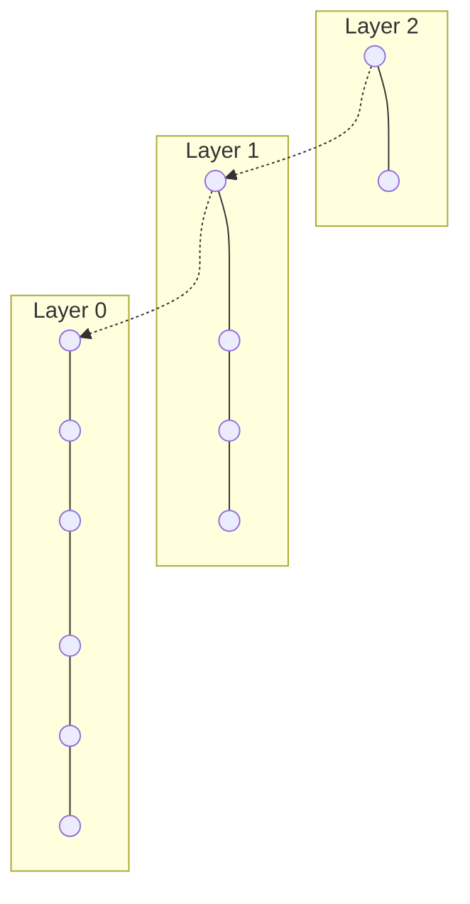

# Vector Databases: The Memory of AI

Vector Databases are designed to store and query high-dimensional embeddings. They power similarity search, recommendation engines, and LLM-based RAG architectures.

---

## 1. What is an Embedding?

An embedding is a numerical representation of an object (text, image, audio) in a multi-dimensional space.
- Similar objects have "closer" vectors.
- Distance is typically measured via **Cosine Similarity** or **L2 Euclidean Distance**.

---

## 2. ANN: Approximate Nearest Neighbor

Finding the *exact* nearest neighbor in a billion vectors is $O(N)$. Vector DBs trade accuracy for speed using **ANN**.
- **IVF (Inverted File)**: Dividing the space into clusters (Voronoi partitions).
- **HNSW (Hierarchical Navigable Small World)**: A graph-based index that allows "skipping" through layers to find neighbors quickly.

---

## 3. HNSW Internals

HNSW builds a multi-layered graph. The top layer has few nodes (long jumps), and the bottom layer has all nodes (local search).

---

## 4. The RAG Pipeline (Retrieval Augmented Generation)

Vector DBs are the "Long-term Memory" for LLMs.
1. **Indexing**: Chunk documents -> Embed -> Store in Vector DB.
2. **Querying**: User query -> Embed -> Semantic Search -> Retrieve Context.
3. **Generation**: Prompt + Context -> LLM -> Answer.

---

## 5. Summary: Vector DB vs. SQL

- **Vector DB**: Searches for "Conceptually similar" things.
- **SQL**: Searches for "Exactly matching" records.

> **Senior Tip**: If asked about scaling, discuss **Product Quantization (PQ)**. It's a lossy compression technique that breaks vectors into smaller sub-vectors, drastically reducing memory usage at the cost of some recall accuracy.
