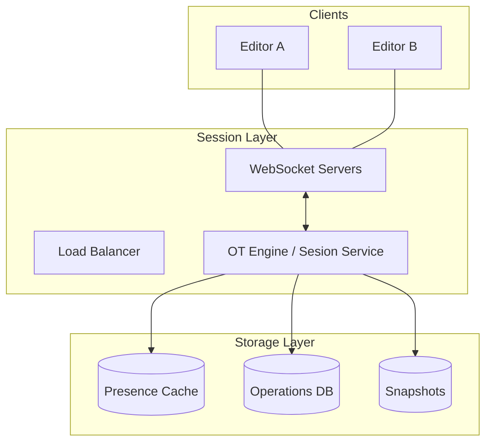

# Problem Breakdown: Designing Google Docs (Ultimate Guide)

Google Docs is a collaborative real-time document editor. The primary challenge is ensuring consistency across multiple concurrent editors while maintaining low latency and providing a seamless "what you see is what I get" (WYSIWYG) experience.

---

## 1. Requirements

### Functional Requirements
- **Collaborative Editing**: Multiple users can edit the same document at once.
- **Real-Time Presence**: See who else is editing and their cursor position.
- **Version History**: View and revert to previous versions of the document.
- **Offline Mode**: Ability to edit without internet and sync later.
- **Formatting**: Support for bold, italics, tables, and images.

### Non-Functional Requirements
- **Low Latency**: Character-level synchronization in < 100ms.
- **Consistency**: All users must eventually see the exact same document state.
- **Reliability**: Document edits must be durable and never lost.
- **Scalability**: Support millions of documents and bursts of high-concurrency editing.

---

## 2. Estimation and Constraints

Assuming **100M active documents**:

### Traffic
- **Daily Edits**: 1 Billion operations (keys pressed) per day ≈ **12K ops per second**.

### Storage & Bandwidth
- **Storage**: Most docs are small (< 100KB). 100M docs * 100KB = **10 TB**. 
- **Bandwidth**: 12K ops/sec * 1KB/op = **12 MB/sec**. Small individual payload but high connection overhead.

---

## 3. Data Model Design

### Core Entities
- **Document**: `doc_id, owner_id, title, content (latest snapshot), created_at`
- **Operation**: `op_id, doc_id, user_id, type (INSERT/DELETE), character, position, version_number`
- **User_Session**: `user_id, doc_id, cursor_position, color`

### Database Selection
- **Relational DB**: Users, Permissions, and Document metadata.
- **NoSQL (Cassandra/Amazon DynamoDB)**: Storing the **Log of Operations**. Every keystroke is an entry. These databases handle high write-throughput perfectly.
- **Blob Storage (S3)**: Storing daily/hourly snapshots of high-traffic documents for fast initialization.

---

## 4. API Design (WebSocket Focused)

Unlike YouTube or Instagram, Google Docs relies heavily on **WebSockets** for the editing session.

- `WS /edit/{docID}`: Establishes a permanent connection for an editing session.
- `pushOperation(op)`: Client sends a message containing the edit.
- `broadcastOperation(op)`: Server sends the validated and transformed operation to all other connected clients.
- `getSnapshot(docID)`: HTTP call to get the latest full state of the doc when opening it.

---

## 5. High-Level Design

---

## 6. Detailed Design: Concurrency Control

This is the "Senior/Staff" level portion of the interview. How do we prevent User A and User B from overwriting each other?

### A. Operational Transformation (OT)
OT is the classic approach used by Google Wave and Docs.
- **Principle**: The server receives an operation, compares it against the version history, and "transforms" the index of the operation if other edits happened in between.
- **Example**: 
    - Doc: "ABC". 
    - User A inserts 'X' at index 1 -> "AXBC".
    - User B deletes 'C' at index 2 (original index) -> "AB".
    - The server transforms User B's delete to index 3 so the final result is "AXB".

### B. Conflict-free Replicated Data Types (CRDTs)
Modern alternative (used by Figma).
- **Principle**: Each character in the document is assigned a unique, immutable ID and a position value (e.g., a fractional number).
- **Rule**: Edits are commutative. No matter what order they arrive, the final state is the same. No central "Transformation" engine is needed, making it better for Peer-to-Peer or extreme scale.

---

## 7. Performance & Optimization

- **Snapshotting**: For a document with 100,000 edits, replaying all of them every time a user joins is too slow. The server takes a "Snapshot" every 100 operations.
- **Ack-Wait Loop**: To keep the logic simple, the client shouldn't send Operation 2 until Operation 1 has been "Acknowledged" by the server. 
- **Debouncing**: Batch several keystrokes into a single WebSocket message (e.g., every 200ms) to reduce network overhead.

---

## 8. Identifying & Resolving Bottlenecks

- **Sticky Sessions**: All users editing the same document should ideally be connected to the same **Session Server**. This simplifies the OT calculation as the server holds the "Source of Truth" in memory.
- **Conflict Resolution for Heavy Docs**: If a document has 50 editors, the OT engine becomes a bottleneck. Use **Sharding** by `doc_id` to distribute load across session servers.
- **Presence Reliability**: User cursors change every second. Use **Redis with short TTLs** to store cursor positions. If a user disconnects, their cursor automatically disappears when the TTL expires.

> **Senior Tip**: Mention **Diff-Match-Patch** as a fallback or optimization for large-scale changes (like copy-pasting a full page). Also, discuss the trade-off of **Consistency vs Availability**. Collaborative editing requires high consistency; OT chooses a central server as the arbiter.
