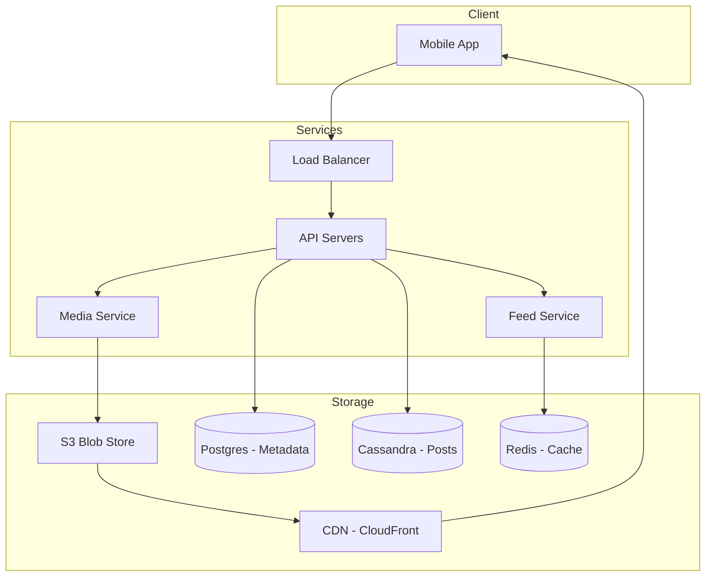

# Problem Breakdown: Designing Instagram (Ultimate Guide)

Instagram is a massive photo and video sharing social media platform. The core challenge is scaling media storage and generating personalized feeds for millions of concurrent users.

---

## 1. Requirements

### Functional Requirements
- **Post Photos/Videos**: Users can upload media and add captions.
- **Follow Users**: Ability to follow/unfollow other users.
- **News Feed**: A chronological or ranked feed of posts from people the user follows.
- **Search**: Search for users or hashtags.
- **Likes & Comments**: Basic social interactions.

### Non-Functional Requirements
- **High Availability**: Reading (viewing feed) is more critical than writing (posting).
- **Low Latency**: Scrolling the feed must be smooth (< 200ms per batch).
- **Scalability**: Support 500M+ DAU and billions of posts.
- **Eventual Consistency**: It's okay if a post takes a few seconds to appear in a follower's feed.

---

## 2. Estimation and Constraints

Assuming **500M DAU**:

### Traffic
- **Uploads**: 50M photos/day ≈ **600 uploads per second**.
- **Reads (Feed)**: Each user views 20 posts/day ≈ **115K reads per second**.

### Storage (5-Year Projection)
- **Metadata**: 50M posts/day * 500 bytes = 25GB/day.
- **Media**: 50M photos/day * 200KB (compressed) = 10TB/day.
- **Total (5 Years)**: 10TB/day * 365 * 5 ≈ **18 PB**.

---

## 3. Data Model Design

### Core Entities
- **User**: `user_id, name, email, profile_pic_url, created_at`
- **Post**: `post_id, user_id, media_url, caption, lat_long, created_at`
- **Follow**: `follower_id, followee_id, created_at`
- **Like**: `post_id, user_id, created_at`

### Database Selection
- **Relational (PostgreSQL)**: Ideal for User data and Follow relationships (ACID compliance).
- **NoSQL (Cassandra)**: Excellent for the `Post` metadata and `Feed` entries. Cassandra's wide-column structure handles time-series-like post data efficiently.
- **Blob Storage (S3)**: All actual photo/video files.

---

## 4. API Design

### Core Endpoints
- `uploadPost(userID, media_id, caption)`: Creates a new post record.
- `getFeed(userID, limit, cursor)`: Retrieves a batch of posts for the user's feed.
- `follow(followerID, followeeID)`: Creates a follow relationship.
- `likePost(userID, postID)`: Increments like count and stores the interaction.

---

## 5. High-Level Design

---

## 6. Detailed Design: The News Feed

This is the most critical part of Instagram's architecture.

### A. Feed Generation: Push vs. Pull

| Approach | Logic | Pros | Cons |
| :--- | :--- | :--- | :--- |
| **Pull (Fan-out on Load)** | When User A opens the app, we query all followers' posts and merge/sort them. | Works great for all users; no pre-computation. | Very slow for users following 1000+ people. |
| **Push (Fan-out on Write)** | When User A posts, we immediately push the post ID into the pre-computed "Feed Cache" of all 10k followers. | Instant feed loading; $O(1)$ read. | Posting is slow for celebrities (e.g., 10M followers = 10M writes). |

### B. The Hybrid Solution
- **Standard Users**: Use **Push**. When they post, update all followers' caches in Redis.
- **Celebrities**: Use **Pull**. Don't push their posts to 50M followers. Instead, when a follower loads their feed, "pull" the celeb's recent posts and merge them into the feed.

---

## 7. Scaling Media & Performance

- **Direct Uploads**: Client requests a **Presigned URL** from the Media Service and uploads directly to S3.
- **Asynchronous Processing**: Once uploaded, a background worker generates thumbnails (Small, Medium, Large) and runs AI moderation/tagging.
- **CDN Strategy**: Use a CDN to cache images globally. 90% of traffic should hit the CDN, not S3.

---

## 8. Identifying & Resolving Bottlenecks

- **Database Sharding**: Shard the `Posts` table by `user_id` so all posts of a user are on the same shard. This makes fetching "User Profile" feeds very fast.
- **Feed Cache Eviction**: Only keep the latest ~500 posts for DAUs in Redis. Inactive users have their cache evicted and reconstructed from DB only if they log in.
- **Thundering Herd**: If a celebrity posts, millions of notifications go out. Use a **Message Queue (Kafka)** to buffer and smooth out the notification load.

> **Senior Tip**: Mention **Consistent Hashing** for the Redis cache layer. If you add a new cache node, you only want to relocate 1/N of your cached feed data, not invalidate everything.
