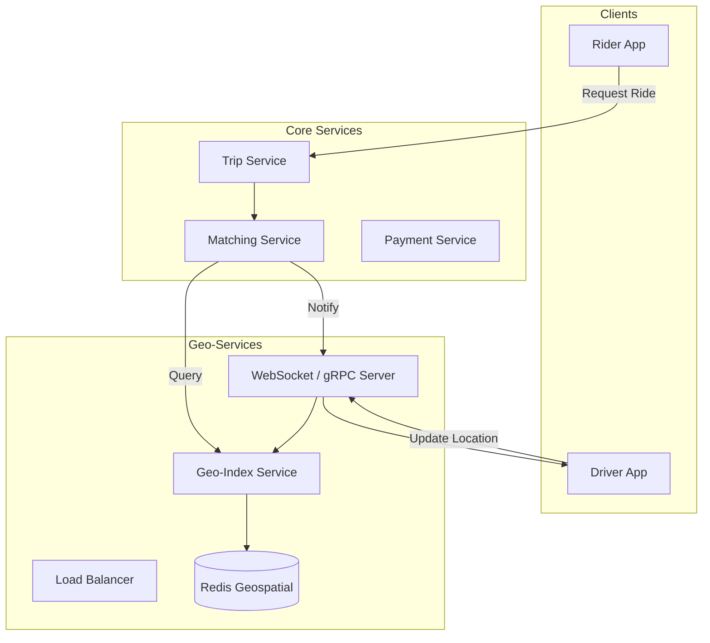

# Problem Breakdown: Designing Uber (Ultimate Guide)

Uber is a massive real-time marketplace connecting riders and drivers. The core challenge is low-latency geospatial indexing, efficient ride matching, and handling consistent location updates from millions of moving vehicles.

---

## 1. Requirements

### Functional Requirements
- **Ride Request**: Rider provides pickup and destination to get a fare estimate.
- **Driver Matching**: System finds the nearest available driver.
- **Location Tracking**: Real-time tracking of drivers on a map.
- **Rider/Driver Interaction**: Acceptance/Cancellation and Trip status.
- **Payments**: Automatic billing at trip completion.

### Non-Functional Requirements
- **High Availability**: Riders must always be able to request a ride.
- **Low Latency**: Matching should happen in < 5 seconds.
- **Accuracy**: Location and fare estimation must be precise.
- **Scalability**: Handle millions of concurrent rides and global traffic spikes.

---

## 2. Estimation and Constraints

Assuming **100M Active Riders** and **5M Active Drivers**:

### Traffic
- **Daily Trips**: 10M trips/day ≈ **115 trips per second**.
- **Location Updates**: 5M drivers update every 4 seconds ≈ **1.25M updates per second**. This is the highest write-load in the system.

### Storage
- **Trip History**: 10M trips/day * 1KB metadata = 10GB/day.
- **Location Logs**: 1.25M updates/sec * 100 bytes = 125MB/sec ≈ 10TB/day for raw pings. Use a TTL for raw pings and archive only processed trip paths.

---

## 3. Data Model Design

### Core Entities
- **Rider**: `rider_id, name, rating, payment_method_id`
- **Driver**: `driver_id, name, car_details, rating, status (Available/Busy)`
- **Trip**: `trip_id, rider_id, driver_id, pickup_lat_long, drop_lat_long, fare, status`
- **Location**: `driver_id, lat_long, timestamp`

### Database Selection
- **Relational (PostgreSQL)**: Users, Profiles, and Payment records.
- **NoSQL (Cassandra)**: Trip history and archived location logs (Time-series data).
- **In-Memory (Redis)**: Current driver locations for real-time proximity search.

---

## 4. API Design

### Core Endpoints
- `requestRide(riderID, pickup, destination)`: Returns `trip_id` and estimated price.
- `updateLocation(driverID, lat, long)`: High-frequency ping from driver app.
- `acceptRide(driverID, tripID)`: Marks the trip as "In Progress".
- `getNearbyDrivers(lat, long, radius)`: Internal API used for matching.

---

## 5. High-Level Design

---

## 6. Detailed Design: Geospatial Indexing

The "Find nearby" problem is the heart of Uber. 

### A. Quadtrees vs. S2 Cells
- **Quadtrees**: Recursive 2D partitioning. Good for variable density (more splits in cities). Use in-memory for speed.
- **Google S2 Geometry**: Uses 64-bit integers (S2 Cells) to map the sphere. Extremely fast for distance calculations and range queries. Hierarchy allows for "zooming" in/out.
- **Redis GEORADIUS**: Uses **Geohashing** internally. Simplest to implement and highly performant for most use cases.

### B. The Matchmaking Flow
1. **Rider requests**: Search radius of 1km in the Geo-Index.
2. **Filter**: Out of 10 nearby drivers, who is `Available` and hasn't rejected this ride before?
3. **Notify**: Send a WebSocket notification to the "best" driver.
4. **Acceptance**: Use a **Distributed Lock (Redis/Zookeeper)** to ensure only one driver can accept the specific trip.

---

## 7. Scaling Write Load (Location Updates)

- **Batched Updates**: Instead of 1 update/sec, the driver app buffers 3-4 pings and sends a batch.
- **Precision vs. Battery**: Only update every 1s if moving; slow down if stationary.
- **Partitioning**: Shard the Location Service by Geohash/Region. This localizes the high write-load and allows for regional scaling.

---

## 8. Identifying & Resolving Bottlenecks

- **Surge Pricing**: Use **Kafka + Flink** to aggregate ride requests vs. driver availability in real-time. If Ratio > Threshold, trigger Surge.
- **Payment failures**: Use **Idempotent** payment keys to prevent double charging. Retry with exponential backoff if the payment gateway is down.
- **Gossip Protocol**: Use a service discovery mechanism to handle the dynamic nature of thousands of WebSocket/gRPC servers.

> **Senior Tip**: Discuss **Adaptive Search Radius**. If no drivers are found in 2km, increment the search to 5km, 10km, etc. This is called "Ring Search". Mention that the system should prioritize drivers with a lower ETA, not necessarily the shortest physical distance.
