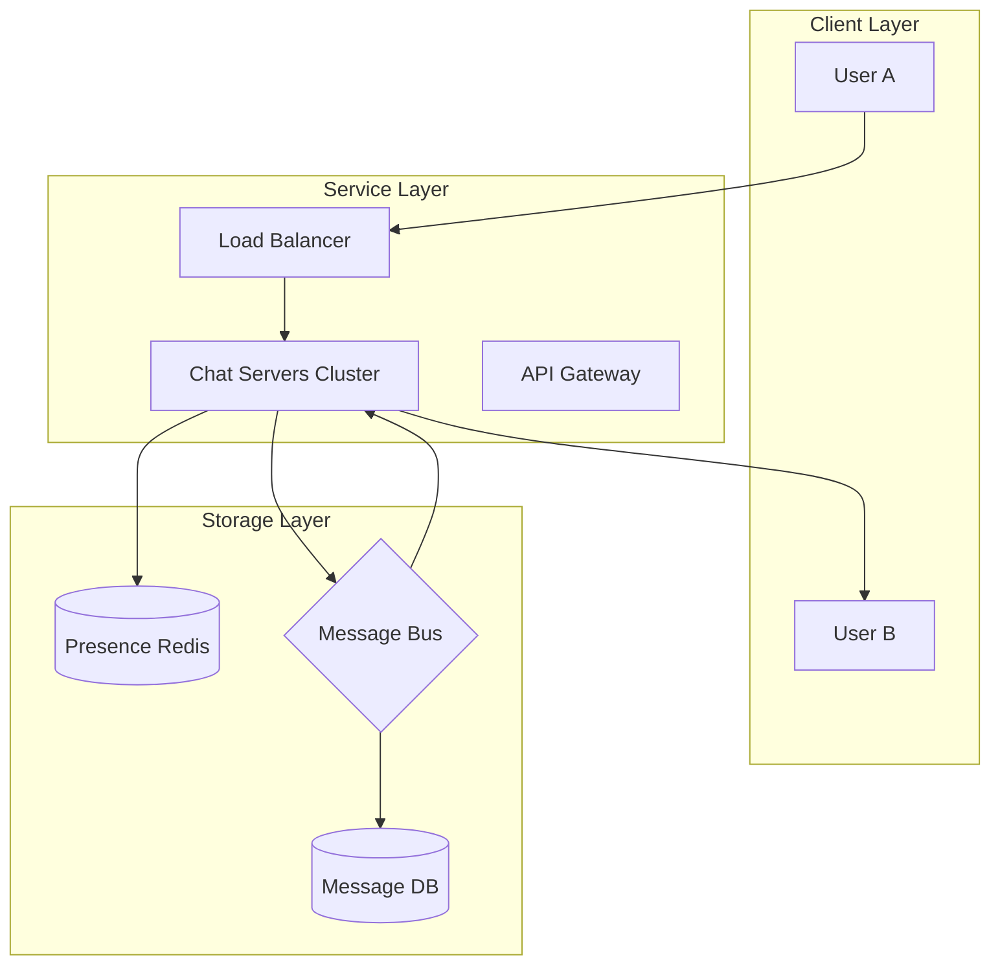

# Problem Breakdown: Designing WhatsApp (Ultimate Guide)

WhatsApp is a global cross-platform instant messaging service. This breakdown covers the architecture required to support billions of users with sub-100ms delivery.

---

## 1. Requirements

### Functional Requirements
- **1:1 & Group Messaging**: Text and media support.
- **Message Status**: Sent, Delivered, Read receipts.
- **User Presence**: Last seen and online status.
- **Media Support**: Images, videos, and document sharing.

### Non-Functional Requirements
- **Low Latency**: Near real-time delivery is the highest priority.
- **High Availability**: 99.99%+ uptime.
- **Scalability**: Handle 2B+ users and massive spikes.
- **Durability**: Zero message loss once confirmed as sent.

---

## 2. Estimation and Constraints

Assuming **50M DAU** (Daily Active Users):

### Traffic
- **Messages**: 50M users * 40 messages/day = **2 Billion messages/day**.
- **RPS**: 2B / 86400 seconds ≈ **24K Requests Per Second**.

### Storage (10-Year Projection)
- **Text**: 2B msgs/day * 100 bytes = 200GB/day.
- **Media**: 5% of messages (100M files) * 100KB = 10TB/day.
- **Total Storage (10 Years)**: (200GB + 10TB) * 365 * 10 ≈ **38 PB**.

---

## 3. Data Model Design

We use a polyglot persistence strategy for maximum scale.

### Core Entities
- **User**: `id, name, phone, last_seen, profile_pic_url`
- **Chat**: `id, type (1:1/group), created_at`
- **Message**: `id, chat_id, sender_id, content, type (text/image), status, created_at`
- **Group_Member**: `group_id, user_id, role (admin/member)`

### Database Selection
- **Metadata (Users/Groups)**: **PostgreSQL** or **MySQL** with read replicas. Relational data is small and needs consistency.
- **Message History**: **Cassandra** or **HBase**. Wide-column stores handle high-velocity append-only writes via LSM-Trees.
- **Presence/Transient State**: **Redis**. In-memory speed for heartbeats and status.

---

## 4. API Design

### Core Endpoints
- `getAllChats(userID)`: Returns list of chats/groups for the user.
- `getMessages(userID, chatID, cursor)`: Paginated message history.
- `sendMessage(senderID, chatID, content, type)`: Returns `task_id` or success.
- `updateStatus(userID, status)`: Heartbeat/Presence update.

---

## 5. High-Level Design

The architecture relies on persistent **WebSockets** for bi-directional real-time communication.

---

## 6. Detailed Design & Optimization

### Real-Time Delivery (The Fan-out)
1. **Sender** pushes message to Chat Server A via WebSocket.
2. **Chat Server A** identifies Receiver B's location via **Consistent Hashing** or a **Global Session Store**.
3. Server publishes to User B's **Pub/Sub topic**.
4. The server holding User B's connection pushes the message.

### Handling Multi-Device & Gaps
- **Client Table**: Tracks all devices (Web, Desktop, Mobile) per user.
- **Sequence Numbers**: Every message has a logical sequence. If a client receives msg #10 after #8, it detects a gap and requests a sync for #9.

### Media Access (Blob Storage)
- **Do not** send media through Chat Servers.
- Use **Presigned URLs** for direct upload to **S3**. 
- Media is served via **CDN** (CloudFront) to reduce latency and origin load.

---

## 7. Security: End-to-End Encryption (E2EE)

WhatsApp uses the **Signal Protocol** (Double Ratchet Algorithm).
- **Client-Side Encryption**: Messages are encrypted on User A's phone using User B's public key.
- **Zero-Knowledge**: The Chat Server only sees metadata (sender/receiver) but cannot decrypt the `content`.

---

## 8. Identifying & Resolving Bottlenecks

- **Single Point of Failure (SPOF)**: Eliminate by running N+1 instances of Chat Servers and using Multi-AZ deployments for DBs.
- **Hotspots**: Group chats with 1000+ members can cause write spikes. Optimize using **write-behind caching**.
- **Notification Robustness**: If WebSocket is closed, fallback to **FCM/APNS** (Push Notifications) via a dedicated Notification Service.

> **Senior Tip**: Discuss **Adaptive Heartbeats**. Instead of a fixed 30s ping, the client can slow down heartbeats when the app is in the background or on low battery to save resources.
