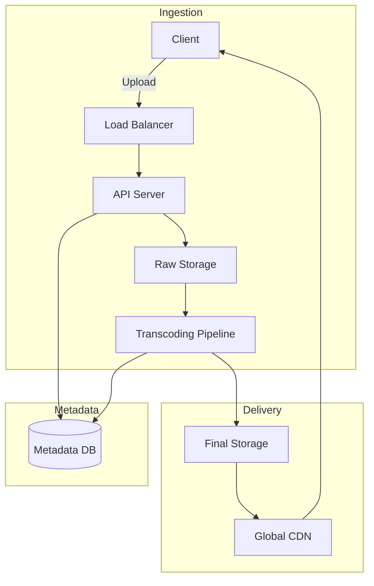

# Problem Breakdown: Designing YouTube (Ultimate Guide)

YouTube is the world's largest video-sharing platform. The primary challenges are handling 500+ hours of video uploaded every minute, processing them into multiple formats (transcoding), and delivering them to billions of users globally with zero buffering.

---

## 1. Requirements

### Functional Requirements
- **Upload Videos**: Users can upload videos up to several GBs.
- **Stream Videos**: Users can watch videos in various resolutions (144p to 4K).
- **Search**: Search for videos by title/tags.
- **User Interactions**: Like, Comment, and Subscribe.
- **Recommendations**: Personalized "Up Next" and Home Feed.

### Non-Functional Requirements
- **High Reliability**: Uploaded videos must never be lost.
- **High Availability**: Streaming must be available 24/7.
- **Low Latency**: Minimal buffering and fast video startup time.
- **Scalability**: Support billions of daily views and massive upload bursts.

---

## 2. Estimation and Constraints

Assuming **2B DAU**:

### Traffic
- **Uploads**: 500 hours/min * 60 min * 24 hrs ≈ **720,000 hours of video per day**.
- **Views**: 5 Billion views/day ≈ **58K views per second**.

### Storage & Bandwidth
- **Storage**: 720k hours * 10GB/hour (average across qualities) ≈ **7.2 PB per day**.
- **Bandwidth**: 5B views * 10MB/view ≈ **50 PB egress per day**. This is why CDNs are non-negotiable.

---

## 3. Data Model Design

### Core Entities
- **User**: `user_id, name, email, subscription_count`
- **Video Metadata**: `video_id, uploader_id, title, thumbnail_url, view_count, created_at`
- **Video_Status**: `video_id, transcoding_job_id, status (Encoding/Ready)`
- **Watch_History**: `user_id, video_id, timestamp, duration_watched`

### Database Selection
- **Relational (PostgreSQL)**: User profiles, subscriptions, and metadata where ACID is needed.
- **NoSQL (Bigtable/Cassandra)**: Watch history and real-time view counts. Bigtable is excellent for high-throughput time-series-like watch data.
- **Blob Store (GCS/S3)**: The source and transcoded video files.

---

## 4. API Design

### Core Endpoints
- `uploadVideo(userID, title, file_stream)`: Initiates the transcoding pipeline.
- `streamVideo(videoID, resolution, offset)`: Requests specific video segments.
- `search(query, page_token)`: Returns paginated video metadata.
- `updateViewCount(videoID)`: High-frequency update for social proof.

---

## 5. High-Level Design

---

## 6. Detailed Design: Transcoding & ABR

### A. The Transcoding Pipeline
When a video is uploaded, it must be converted into multiple formats (Codecs like H.264, VP9) and resolutions.
1. **Segmentation**: Break the video into 2-5 second chunks.
2. **Parallel Processing**: Different workers encode chunks into 144p, 360p, 1080p, etc., simultaneously.
3. **Manifest Creation**: Generate an **M3U8** or **MPD** file that lists the locations of all segments.

### B. Adaptive Bitrate Streaming (ABR)
The client (Player) doesn't download one big file. It fetches segments.
- If the network is slow, the player requests the 360p segment next.
- If the network speeds up, it switches to 1080p for the following segment.
- This ensures **zero buffering** by prioritizing playback over resolution.

---

## 7. Scaling Content Delivery (CDN)

- **Edge Caching**: Highly popular videos (Trending) are cached at PoPs (Points of Presence) near users.
- **Long-tail Content**: Rare videos are fetched from the origin (S3) on-demand.
- **ISP Colocation**: Google installs "Google Global Cache" (GGC) nodes inside ISP data centers to serve traffic directly within the local network.

---

## 8. Identifying & Resolving Bottlenecks

- **Write Heavy Metadata**: View counts can be "hot." Use **In-memory Aggregation** (Redis) and flush to the DB every few minutes or use a distributed counter pattern.
- **Storage Deduplication**: Users often upload the same meme/clip. Use **Content-Addressable Storage (CAS)** (hashing) to avoid storing the same 1GB video multiple times.
- **Recommendation Cold-Start**: Use a separate ML service (often based on Collaborative Filtering or Deep Learning) to pre-calculate recommendations for active users.

> **Senior Tip**: Discuss **Resumable Uploads**. For giant 50GB files, use **Chunked Uploads** with a `session_token`. If the connection drops at 90%, the client can resume from the last successful chunk instead of restarting.
