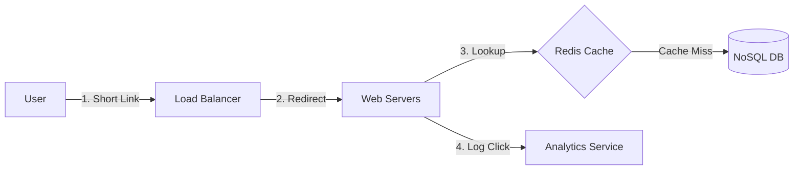

# Problem Breakdown: Designing Bit.ly (Ultimate Guide)

A URL shortener like Bit.ly is a service that creates short aliases for long URLs. The primary challenges are handling high read volumes, ensuring unique/non-guessable short links, and managing low-latency redirects.

---

## 1. Requirements

### Functional Requirements
- **URL Shortening**: Generate a unique short alias for a long URL.
- **Redirection**: Redirect users from the short link to the original long URL.
- **Custom Aliases**: Allow users to define their own short links.
- **Analytics**: Track click counts and basic user metadata (optional but common).

### Non-Functional Requirements
- **High Availability**: Redirection must be sub-100ms and 99.99% available.
- **Low Latency**: The redirect shouldn't add perceptible delay.
- **Scalability**: Handle billions of new URLs and exponential read traffic.
- **Uniqueness**: Each short link must be unique.

---

## 2. Estimation and Constraints

Assuming **100M new URLs per month** and a **100:1 Read-to-Write ratio**:

### Traffic
- **Writes (Shortening)**: 100M / (30 days * 86400s) ≈ **40 URLs per second**.
- **Reads (Redirects)**: 40 * 100 ≈ **4,000 redirects per second**.

### Storage & URL Length
- **Short URL Length**: Using Base62 (a-z, A-Z, 0-9), a 6-character string gives $62^6 \approx 56.8$ Billion combinations. 7 characters give $62^7 \approx 3.5$ Trillion. 
- **Recommendation**: 7 characters is safest for 10+ years.
- **Storage (10 Years)**: 100M/month * 12 months * 10 years * 500 bytes (URL + metadata) ≈ **6 TB**.

---

## 3. Data Model Design

### Core Entities
- **URL_Mapping**: `short_hash (PK), original_url, created_at, user_id`
- **User**: `user_id, email, password_hash, created_at`

### Database Selection
- **NoSQL (MongoDB / DynamoDB)**: Ideal for a simple Key-Value lookup pattern. We don't need complex relations, just high-throughput $O(1)$ read/write by `short_hash`.

---

## 4. API Design

### Core Endpoints
- `shortenURL(longURL, customAlias?, apiKey)`: Returns the shortened URL.
- `GET /{short_hash}`: Redirects to the long URL.
- `getAnalytics(short_hash)`: Returns click data for the link.

---

## 5. High-Level Design

---

## 6. Detailed Design: Key Generation Service (KGS)

Calculating a hash (MD5/SHA) on the fly can lead to collisions or require expensive DB checks (`IF NOT EXISTS`).
- **The KGS Pattern**: A separate service pre-calculates unique 7-character strings and stores them in a "Key DB".
- **Usage**: When the API needs a short link, it simply "grabs" an unused key from the KGS.
- **Concurrency**: KGS keeps keys in memory. To avoid multiple servers grabbing the same key, it uses two tables: `Available_Keys` and `Used_Keys`.

---

## 7. Redirection: 301 vs 302

- **301 (Moved Permanently)**: The browser caches the redirect. Subsequent clicks don't hit our server. **Good for performance**, bad for analytics.
- **302 (Found/Temporary)**: The browser hits our server Every Time. **Best for accurate analytics**, slightly higher latency for the user.
- **Interview Tip**: Recommend **302** if the client needs precise tracking (typical for paid campaigns).

---

## 8. Identifying & Resolving Bottlenecks

- **Cache Everything**: Since URLs are immutable, we should cache 20% of the most active links in **Redis**. This will handle 80% of traffic.
- **Database Cleanup**: URLs don't need to live forever. Implement a TTL (Time To Live) or a background worker to delete URLs that haven't been clicked in 2+ years.
- **Predictable Keys**: Don't use sequential keys (1, 2, 3...) or people can "scrape" your entire DB. KGS should shuffle the keys.

> **Senior Tip**: Mention **Edge Redirection**. Move the URL mapping to a **Cloudflare Worker/Lambda@Edge**. The redirection happens at the PoP, literally as close to the user as possible, resulting in ~10ms redirects.
