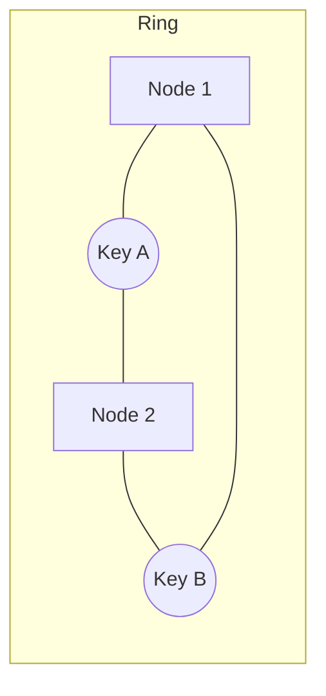
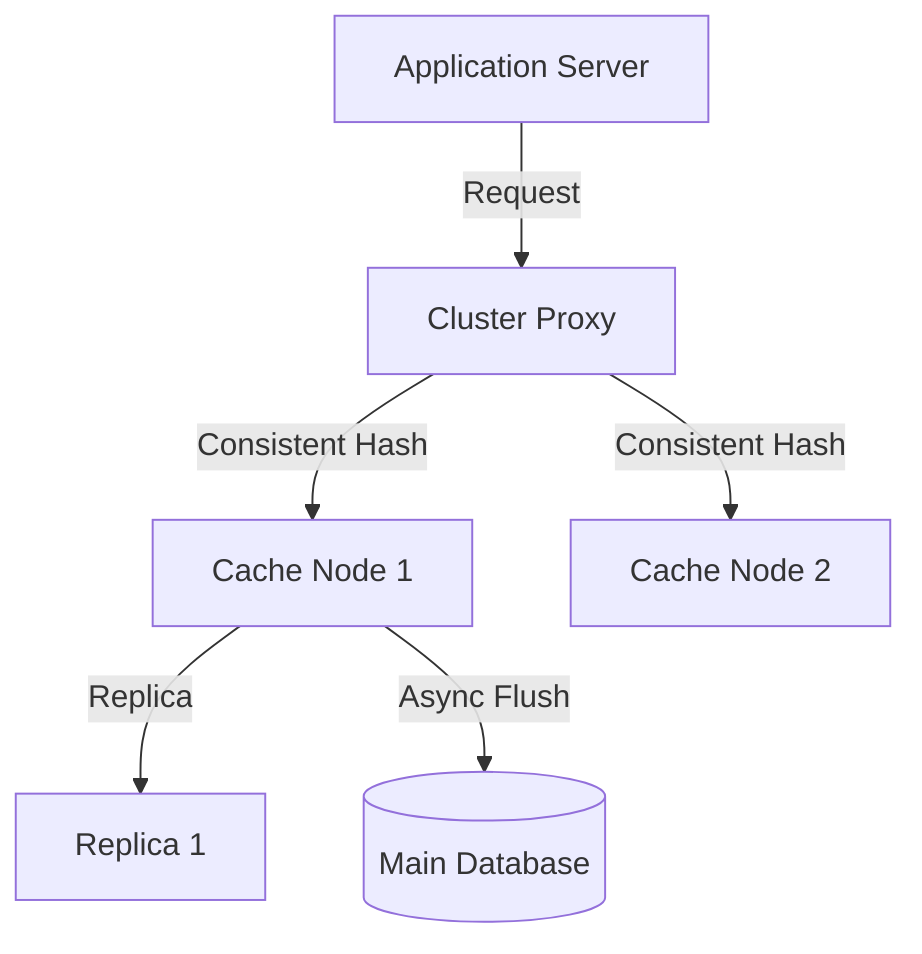

# Problem Breakdown: Designing a Distributed Cache (Ultimate Guide)

A distributed cache (like Redis or Memcached) is an in-memory data store used to speed up applications. The core challenge is maintaining high availability, low latency, and efficient memory management while scaling horizontally.

---

## 1. Requirements

### Functional Requirements
- **Key-Value API**: Support `get(key)`, `put(key, value)`, and `delete(key)`.
- **Expiration**: Set a Time-To-Live (TTL) for each key.
- **Eviction**: Automatically delete old or unused data when memory is full.

### Non-Functional Requirements
- **Low Latency**: Sub-millisecond response times.
- **High Scalability**: Support millions of RPS and dynamic cluster resizing.
- **Availability**: High uptime (99.99%) with data replication.
- **Consistency**: Configurable consistency (usually eventual but can be strong).

---

## 2. Estimation and Constraints

Assuming a **Large-scale System (e.g., Twitter/Facebook)**:

### Traffic
- **RPS**: 1 Million Reads, 100K Writes.
- **Performance**: < 1ms response time.

### Storage
- **Memory**: 500 GB total data. 
- **Nodes**: 16 servers with 32GB RAM each.

---

## 3. Core Architecture: Consistent Hashing

To scale beyond one server, we must partition data.
- **The Problem**: Simple modulo partitioning (`hash(key) % N`) causes massive cache misses if a node is added or removed.
- **The Solution**: **Consistent Hashing**. Map keys and nodes onto a virtual ring. Adding a node only relocates $1/N$ of the keys.

---

## 4. Eviction Policies: Which one to use?

| Policy | Logic | Best For |
| :--- | :--- | :--- |
| **LRU (Least Recently Used)** | Discards the key that hasn't been used for the longest time. | Most real-world scenarios. |
| **LFU (Least Frequently Used)** | Discards the key with the lowest access count. | When frequency is more important than recency. |
| **FIFO (First In First Out)** | Discards the oldest key regardless of usage. | Simple time-based data. |
| **Random** | Discards a key at random. | Low overhead, surprisingly effective for high-load. |

---

## 5. Caching Strategies (Consistency Models)

### A. Cache-Aside (Lazy Loading)
1. Check Cache. If miss, fetch from DB.
2. Store result in Cache for next time.
- **Pros**: Handles node failures gracefully. Simple.

### B. Write-Through
1. Write to Cache first.
2. Cache synchronously writes to DB.
- **Pros**: Data is always consistent. **Cons**: Write latency is high.

### C. Write-Behind (Write-Back)
1. Write to Cache only.
2. Cache asynchronously flushes to DB.
- **Pros**: Extremely fast writes. **Cons**: Data loss risk if cache crashes before DB write.

---

## 6. High-Level Design

---

## 7. Scaling & High Availability

- **Leader-Follower Replication**: Every "Leader" node has 1-2 "Follower" nodes. If the leader dies, a follower is promoted via **Zookeeper/Sentinel**.
- **Cold vs. Warm Startup**: If a new cluster is started, the "Cache Miss" storm can kill the DB. **Pre-warm** the cache with popular keys using a script.

---

## 8. Identifying & Resolving Bottlenecks

- **Cache Stampede (Thundering Herd)**: When a popular key expires, 10,000 requests hit the DB at once. 
    - **Fix**: Use a **Global Lock**. Only one request fetches from DB; others wait for the cache to be updated.
- **Hot Keys**: A celebrity profile key might overwhelm a single shard. 
    - **Fix**: Replicate the key across multiple shards or use **Local Caching** in the app layer.
- **Garbage Collection**: In Java/Go based caches, GC pauses can kill latency. Use **Off-heap Memory** management for the actual data storage.

> **Senior Tip**: Discuss **Bloom Filters** as a cache-front. If a key isn't in the Bloom Filter, it definitely isn't in the DB. This prevents "Cache Penetration" (queries for non-existent IDs hitting the DB directly).
