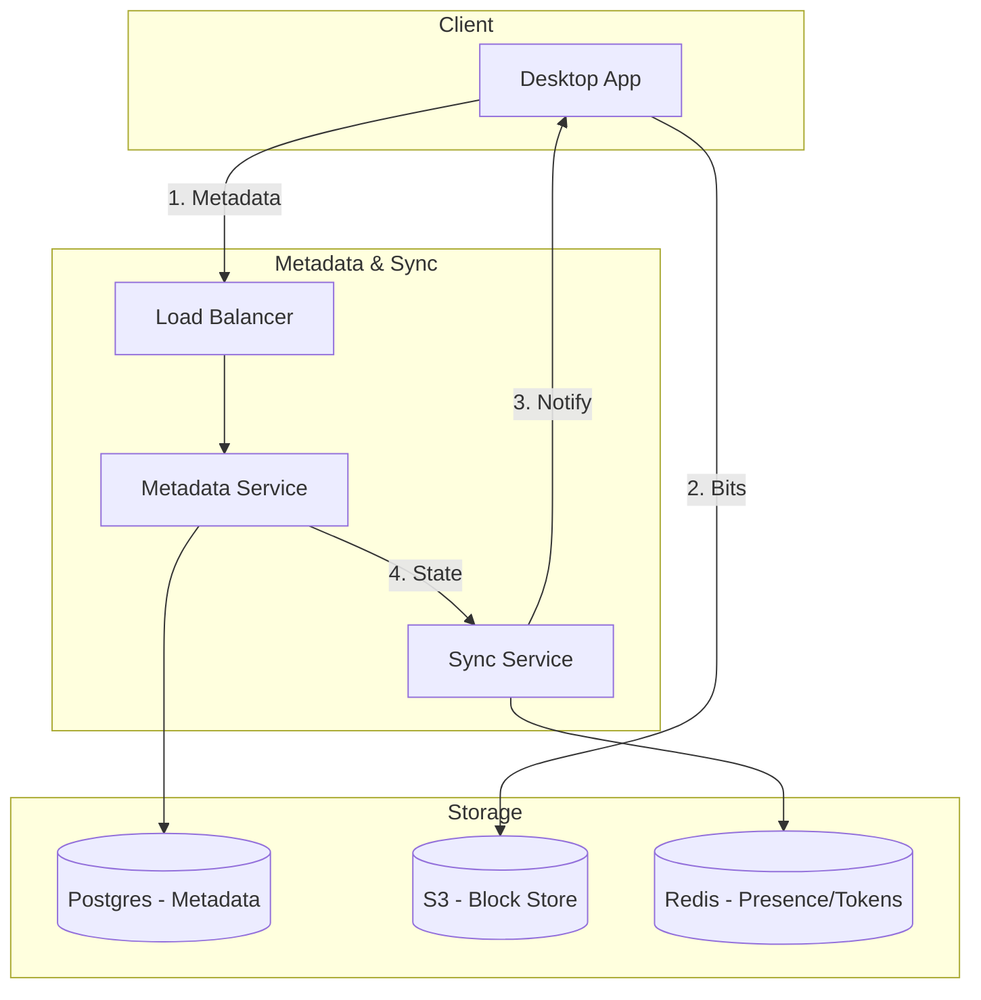

# Problem Breakdown: Designing Dropbox (Ultimate Guide)

Dropbox is a cloud storage and file synchronization service. The core challenge is efficiently syncing large files across many devices while minimizing bandwidth and storage costs through deduplication.

---

## 1. Requirements

### Functional Requirements
- **File Upload/Download**: Support files up to several GBs.
- **Synchronization**: Changes on one device must propagate to all others.
- **File Versioning**: Ability to view and restore previous versions (e.g., last 30 days).
- **Sharing**: Share files/folders with other users via links or permissions.

### Non-Functional Requirements
- **Durability**: 99.999999999% (11 nines) file durability. Data loss is unacceptable.
- **Consistency**: Strong consistency for file metadata.
- **Performance**: High-speed uploads and fast sync notifications.
- **Storage Efficiency**: Optimize storage through deduplication.

---

## 2. Estimation and Constraints

Assuming **500M Users** and **100M active daily**:

### Traffic
- **Edits/Syncs**: 10 edits per user/day ≈ **11K sync events per second**.

### Storage & Bandwidth
- **Total Storage**: 500M users * 10GB avg = **5 Exabytes**.
- **Bandwidth**: Use differential sync (only upload changes) to reduce bandwidth by 90% compared to full file uploads.

---

## 3. Data Model Design

### Core Entities
- **User**: `user_id, name, quota_limit, used_storage`
- **File_Metadata**: `file_id, folder_id, name, latest_version_id, is_deleted`
- **File_Block (The "Bit" level)**: `block_id (hash), size, storage_path`
- **File_Version**: `version_id, file_id, list_of_block_ids, created_at`

### Database Selection
- **Relational (PostgreSQL)**: Critical for file metadata and hierarchical folder structures. Sharded by `user_id`.
- **Blob Storage (S3)**: The source for all actual file chunks/blocks.

---

## 4. API Design

### Core Endpoints
- `uploadFile(file_id, chunk_data, offset)`: Resumable chunked upload.
- `downloadFile(file_id, version_id)`: Retrieves the block list and then the actual bits.
- `getUpdates(user_id, last_sync_token)`: Used by the client to poll/notify for changes.

---

## 5. High-Level Design

---

## 6. Detailed Design: Block-level Sync

### A. Chunking & Indexing
Instead of treating a file as one object, break it into **4MB blocks**.
1. **Delta Sync**: If you edit one sentence in a 100MB PDF, only 1-2 chunks change. We only upload those.
2. **Deduplication**: Before uploading a block, the client sends the SHA-256 hash. If that hash already exists in the "Block DB" (uploaded by another user), the server tells the client: "Don't upload, I already have it."

### B. Synchronization Engine
The sync service uses **Long Polling** or **WebSockets** to keep the client "live."
1. Client A uploads a file.
2. Metadata Service updates the DB and pushes a message to the **Synchronization Queue**.
3. Sync Service identifies all devices owned by User A (and all shared users).
4. Sync Service sends a "New Update Available" notification.
5. Client B receives notification and pulls the metadata to see which chunks to download.

---

## 7. Performance & Optimization

- **Client-side Hashing**: Always calculate block hashes on the client to avoid redundant data transfer.
- **Compression**: Compress chunks before uploading to S3.
- **Cold Storage**: Move older versions of files (e.g., version from 2 months ago) to **S3 Glacier** to save massive storage costs.

---

## 8. Identifying & Resolving Bottlenecks

- **Notification Storm**: If a shared folder with 500 users is updated, don't spam them all instantly. Batch notifications or use a pull-based mechanism for very large shared folders.
- **Metadata Scaling**: Shard the metadata DB by `user_id` or `root_folder_id`. Since most operations stay within a user's namespace, this avoids cross-shard joins.
- **Conflicts**: If two users edit the same file simultaneously, the system creates a **"Conflicted Copy"** (e.g., `file (User A's conflicted copy).txt`).

> **Senior Tip**: Discuss **Offline Reconciliation**. When a client comes back online after 2 days, it shouldn't just upload everything. It should download the server-side "Operation Log" since its `last_sync_token`, reconcile local changes, and then perform a minimal set of uploads.
