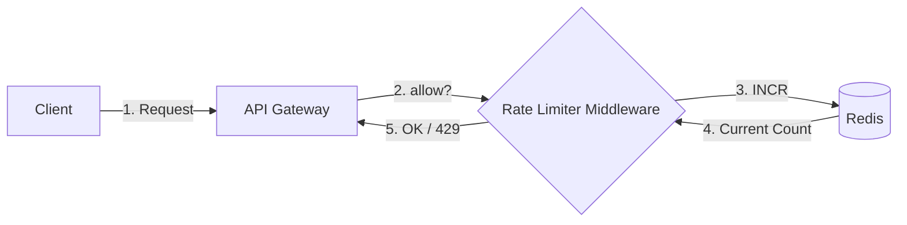

# Problem Breakdown: Designing a Distributed Rate Limiter (Ultimate Guide)

Rate limiters protect services from being overwhelmed by too many requests (DDoS protection, API quotas). In a distributed system, the challenge is maintaining accurate counts across multiple servers with minimal latency.

---

## 1. Requirements

### Functional Requirements
- **Throttling**: Limit requests based on API Key, IP, or User ID.
- **Rules Configuration**: Define limits (e.g., 100 requests/minute).
- **Error Handling**: Return HTTP 429 (Too Many Requests) when limit is exceeded.

### Non-Functional Requirements
- **Low Latency**: The check must add < 5ms to the request lifecycle.
- **Wait-Free/High Throughput**: Must handle millions of requests/second.
- **Accuracy**: Counter must be consistent across a distributed cluster.
- **Fault Tolerance**: If the rate limiter dies, the service should ideally "Fail-Open" (allow requests) rather than block the entire API.

---

## 2. Estimation and Constraints

Assuming **1 Million RPS (Requests Per Second)**:

### Traffic
- **RPS**: 1M.
- **Latency Budget**: < 1ms for the lookup.

### Storage
- **Keys**: 10M active users * 128 bytes (Key + Counter) ≈ **1.2 GB**. This fits easily in **Redis**.

---

## 3. Algorithms: Choosing the Right One

| Algorithm | Pros | Cons |
| :--- | :--- | :--- |
| **Token Bucket** | Efficient, allows bursts. | Hard to implement accurately in distributed env without locks. |
| **Leaky Bucket** | Smoothes traffic. | Can block valid requests if queue is full. |
| **Fixed Window** | Simple. | Spikes at window boundaries (Double-dipping). |
| **Sliding Window Counter** | Accurate and space-efficient. | Slightly more complex math. |

> **Best Choice**: **Sliding Window Counter**. It weights the current window and the previous window to provide a smooth, accurate rate without the "boundary" spike.

---

## 4. High-Level Design

---

## 5. Detailed Design: Distributed Challenges

### A. Atomicity (Race Conditions)
If two servers increment the same count simultaneously, we might lose one increment.
- **Solution**: Use **Redis Lua Scripts**. These are executed atomically on the Redis server, ensuring the "Read-Modify-Write" cycle is safe.

### B. Performance (The Redis Trip)
Fetching from Redis every time adds ~2ms.
- **Optimization**: Use **Local Caching (L1)**. Store a small percentage of the quota on the local server. Only hit Redis when the local cache is exhausted or after 1 second.
- **Batching**: Sync local counts to Redis in batches to reduce network I/O.

---

## 6. Rules Management

Store rules in a specialized **Config Database** (PostgreSQL) and push updates to the Middleware via **Pub/Sub**.
- Example Rule: `{"endpoint": "/v1/search", "limit": 100, "window": "60s", "scope": "IP"}`.

---

## 7. Global vs Local Limiters

- **Global**: One Redis cluster for the whole world. Accurate but high latency for cross-region requests.
- **Regional**: One Redis per AWS Region. Fast but allows a user to "bypass" the limit by switching regions. 
- **Recommendation**: Use Regional limiters for better availability and performance.

---

## 8. Identifying & Resolving Bottlenecks

- **Redis as SPOF**: If Redis goes down, the Middleware should **Fail-Open**. It's better to allow too many requests for a few minutes than to crash your whole business.
- **Hot Keys**: If one API key is viral (e.g., a popular integration), its Redis shard will be overwhelmed. Use **Redis Sharding** or **Local Aggretation** to distribute the load.

> **Senior Tip**: Mention **Client-Side Throttling**. If the server returns a 429, it should include a `Retry-After: 30` header. Well-behaved clients will back off, reducing the load on the rate limiter itself.
