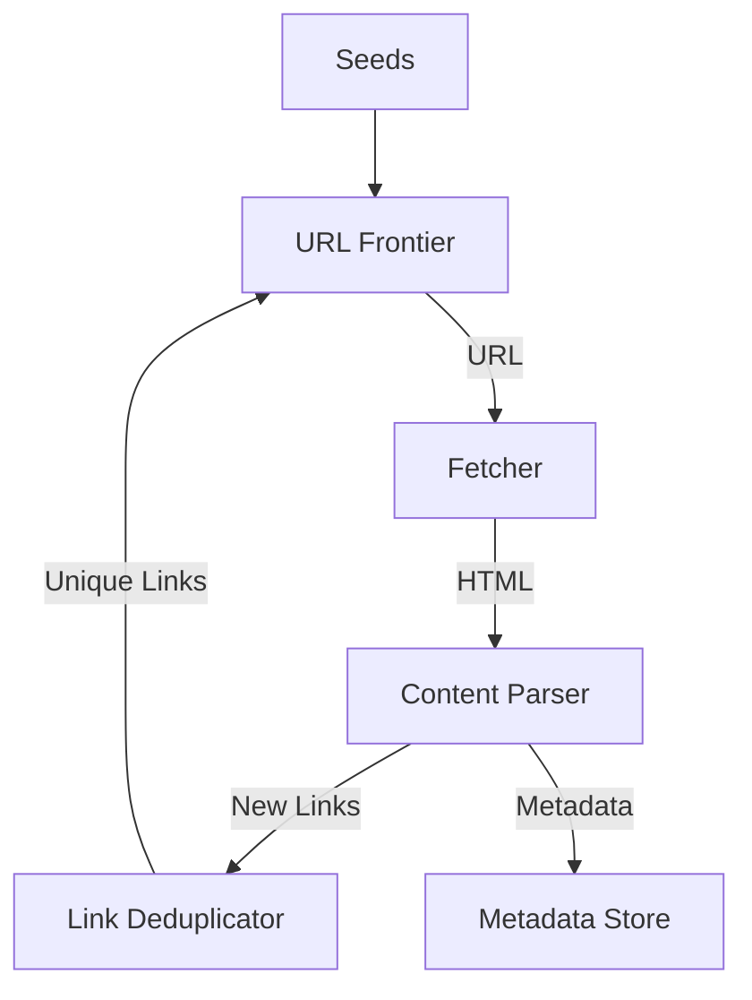

# Problem Breakdown: Designing a Web Crawler (Ultimate Guide)

A web crawler (like Googlebot) is a system that browses the internet to index content. The core challenge is scaling to billions of pages while remaining "polite" to web servers and handling infinite loops and traps.

---

## 1. Requirements

### Functional Requirements
- **Traverse URLs**: Start from "seeds" and find new links recursively.
- **Content Storage**: Store the HTML/Metadata of pages for indexing.
- **Politeness**: Do not overwhelm a single domain with too many requests.
- **Freshness**: Periodically re-crawl pages to find updates.

### Non-Functional Requirements
- **Scalability**: Handle 100B+ pages.
- **Extensibility**: Support different content types (PDF, Images, JS).
- **Efficiency**: Minimize network bandwidth and storage.
- **Robustness**: Handle dead links, slow servers, and "Crawler Traps" (infinitely nested URLs).

---

## 2. Estimation and Constraints

Assuming we want to crawl **10 Billion pages per month**:

### Traffic
- **Avg Page Size**: 100 KB.
- **Egress (Download)**: 10B * 100 KB = **1 Petabyte / month**.
- **Bandwidth**: 1PB / month ≈ **4 Gbps sustained**.

### Storage
- **Metadata**: 10B pages * 500 bytes = **5 TB**.
- **Raw Content**: 1 PB (usually compressed to ~200 TB).

---

## 3. High-Level Design: The Architecture

---

## 4. Detailed Design: Key Components

### A. The URL Frontier (The Priority Queue)
The Frontier decides "What to crawl next."
- **Prioritization**: High-quality or frequently updated sites should be crawled more often.
- **Freshness**: Use a **Min-Heap** based on `last_crawled_time + refresh_interval`.

### B. Politeness Policy
To avoid DDOSing a small blog:
1. One Host = One Worker.
2. Maintain a map of `host_id -> last_access_time`.
3. Wait at least 1-2 seconds between requests to the same host.

### C. Deduplication (Bloom Filters & SimHash)
1. **URL Deduplication**: Before adding to Frontier, check if the URL has been seen. Use a **Bloom Filter** in memory for 99.9% accuracy with minimal space.
2. **Content Deduplication**: Two different URLs might have the same content (e.g., `?shash=123` params). Use **SimHash** (Locality Sensitive Hashing) to detect "near-duplicates" and only store one version.

---

## 5. Scaling Challenges

- **DNS Resolution**: Standard DNS is too slow for 10k requests/sec. Maintain a **Local DNS Cache** updated by a background worker.
- **Distributed Crawling**: Divide the internet by Geohash or Domain-range among different crawler clusters to minimize cross-region latency.
- **Dynamic Content**: Static HTML is easy. For JS-heavy sites (React/Vue), you need a **Headless Browser (Puppeteer/Playwright)** worker, which is 10x more expensive in CPU.

---

## 6. Handling Crawler Traps

A trap is an infinite loop of URLs (e.g., `/calendar/2024/march/2025/april...`).
- **Depth Limiting**: Stop after N levels of depth from the seed.
- **Link Normalization**: Convert `URLA.com/test` and `URLa.com/test/` to a single canonical format.
- **Pattern Matching**: Detect and skip URLs with suspicious repetitive patterns.

---

## 7. Summary Table: Technical Choices

| Problem | Technical Choice | Rationale |
| :--- | :--- | :--- |
| **URL Storage** | HBase / Cassandra | Columnar stores handle billions of rows efficiently. |
| **Deduplication** | Bloom Filters | Space efficiency is critical for trillions of items. |
| **Frontier** | Kafka / SQS | Decouples Fetchers from Link Parsers. |
| **Parsing** | HTML5lib / BeautifulSoup | Must be robust against "malformed" HTML. |

> **Senior Tip**: Discuss **Robots.txt**. A well-behaved crawler must fetch the `/robots.txt` file for every domain first and Cache it. Respecting the `crawl-delay` and `disallow` directives is a legal/ethical requirement in real-world scraping.
