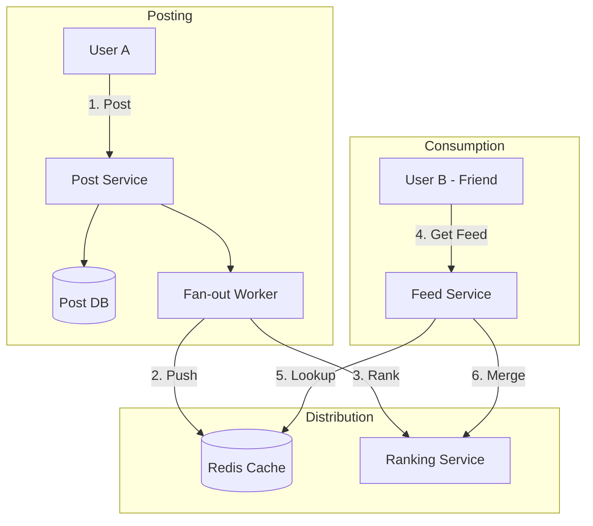

# Problem Breakdown: Designing Facebook News Feed (Ultimate Guide)

The Facebook News Feed is one of the most complex high-scale systems in existence. The core challenge is aggregating posts from friends and followed pages, ranking them by relevance, and delivering them to millions of users with low latency.

---

## 1. Requirements

### Functional Requirements
- **Post Feed**: Users can see a ranked list of posts from friends and followed pages.
- **Post Creation**: Users can create posts with text, images, or videos.
- **Social Interactions**: Like, comment, and share.
- **Pagination**: Smoothly scroll through the feed.

### Non-Functional Requirements
- **High Availability**: Feed must always be available for reading.
- **Low Latency**: Feed should load in < 200ms.
- **Eventually Consistent**: New posts don't need to appear instantly (seconds delay is okay).
- **Scalability**: Support billions of users and millions of new posts daily.

---

## 2. Estimation and Constraints

Assuming **2B DAU**:

### Traffic
- **Reads**: 2B users * 5 feed refreshes/day = 10B Reads/day ≈ **115K RPS**.
- **Writes**: 200M posts/day ≈ **2.3K RPS**.

### Storage & Cache
- **Post Metadata**: 200M * 500 bytes = 100GB/day.
- **Feed Cache**: Caching the latest ~500 posts for all 2B users. 2B * 500 * 8 bytes (ID) ≈ **8 TB of Redis storage**.

---

## 3. Data Model Design

### Core Entities
- **User**: `user_id, name, friends_list`
- **Post**: `post_id, author_id, content, media_urls, created_at`
- **Feed**: `user_id, list_of_post_ids` (Pre-computed in Redis)

### Database Selection
- **Relational (PostgreSQL)**: User data and "Friends" graph (ideal for complex joins).
- **NoSQL (Cassandra)**: Post metadata (handles high write throughput and partitions well).
- **In-Memory (Redis)**: Pre-computed user feeds for $O(1)$ read performance.

---

## 4. High-Level Design

---

## 5. Detailed Design: The Fan-out Strategy

"Fan-out" is the process of pushing a post to all of a user's friends.

### A. Push Model (Fan-out on Write)
When User A posts, the system immediately pushes the `post_id` to the Redis caches of all 1,000 friends.
- **Pro**: Feed loading is $O(1)$.
- **Con**: Large write load for users with many friends.

### B. Pull Model (Fan-out on Load)
Caches are not pre-computed. When User B opens the app, the system queries all 500 friends, fetches their recent posts, and ranks them on the fly.
- **Pro**: Great for celebrities (no massive write storm).
- **Con**: Slow feed loading for standard users.

### C. The Hybrid Approach (Industry Standard)
- **Normal Users**: Use **Push**.
- **Celebrities (100k+ followers)**: Use **Pull**. 
- When a user loads their feed, the system merges their pre-computed "Friends Feed" (Push) with the recent "Celebrity Posts" (Pull).

---

## 6. Ranking Service

The feed isn't just chronological; it's ranked by "Relevance" (EdgeRank).
- **Affinity**: How often do you interact with the author?
- **Weight**: Video > Photo > Text.
- **Time Decay**: Newer posts are better.
- **Implementation**: A separate microservice running ML models (Collaborative Filtering / Neural Networks) that scores posts before they hit the cache.

---

## 7. Scaling & Resilience

- **Graph Storage**: The friend relationship graph can be massive. Consider using a **Graph Database (Neo4j)** or specialized in-memory graph engines (like Facebook's Tao).
- **Feed Cache Eviction**: Only keep the feed for DAUs (Daily Active Users). If a user hasn't logged in for 3 days, delete their Redis cache to save memory. Reconstruct it when they return.
- **Post Caching**: Don't just store IDs in the Feed Cache; store a small "Post Preview" (ID, text, thumbnail_url) to skip an extra DB call during feed rendering.

> **Senior Tip**: Mention **Async Post Processing**. Image resizing and AI-based safety checks should happen via **Kafkas/RabbitMQ** workers before the post is fanned out to friends.
