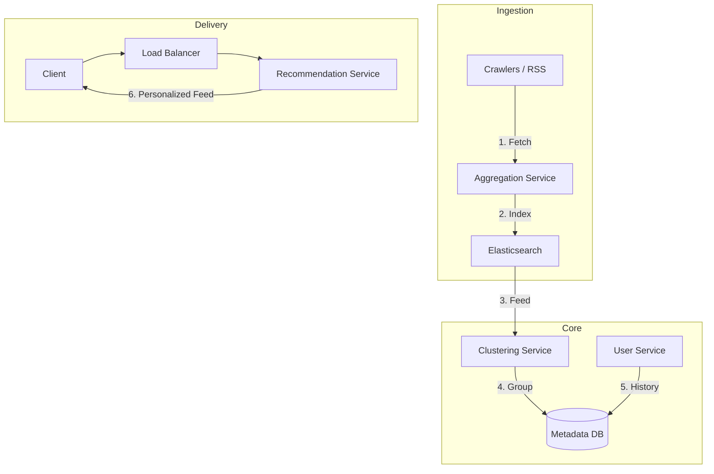

# Problem Breakdown: Designing Google News (Ultimate Guide)

Google News is a massive aggregator that gathers, clusters, and ranks news articles from thousands of sources. The primary challenges are handling the high-volume ingestion of real-time articles, clustering similar stories into "events," and providing a personalized experience based on user interests.

---

## 1. Requirements

### Functional Requirements
- **Aggregation**: Ingest articles from RSS feeds and periodic web crawling.
- **Clustering**: Group related articles about the same event into a single headline.
- **Personalization**: Recommend news based on user location, reading history, and followed topics.
- **Search**: Search for historical and current news articles.

### Non-Functional Requirements
- **Freshness**: New stories must appear within minutes of being published.
- **High Availability**: Users expect 100% uptime for browsing.
- **Scalability**: Support millions of sources and billions of end-users.
- **Relevance**: Ensure high quality and avoid spam/duplicate content.

---

## 2. Estimation and Constraints

Assuming **500M Daily Active Users**:

### Traffic
- **Ingestion**: 100,000 articles per day from 50k sources ≈ **1.2 articles per second**.
- **Reads**: 500M DAU * 2 refreshes/day ≈ **11.5K Reads/second**.

### Storage (Metadata & Thumbnails)
- **Metadata**: 100k articles/day * 2kb = 200MB/day.
- **Content Cache**: Only store the latest 3-7 days of results in a hot cache.

---

## 3. Data Model Design

### Core Entities
- **Source**: `source_id, domain, name, trust_score`
- **Article**: `article_id, source_id, title, url, snippet, timestamp, cluster_id`
- **Cluster**: `cluster_id, top_headline_id, category (Sports, Tech), created_at`
- **User_Profile**: `user_id, interested_topics, history_list`

### Database Selection
- **Relational (PostgreSQL)**: Source management and User preferences.
- **Search Engine (Elasticsearch)**: The primary storage for articles. Lucene-based search enables fast filtering by category, time, and keywords.
- **NoSQL (Bigtable)**: User reading history (time-series).

---

## 4. High-Level Design

---

## 5. Detailed Design: Clustering & Event Detection

How does Google show 20 articles under one "Breaking News" headline?

### A. Feature Extraction
For every new article, extract key features:
- **Keywords**: Use **TF-IDF** (Term Frequency-Inverse Document Frequency) to find the most unique words (e.g., "Earthquake", "Taiwan").
- **Entities**: Extract names, locations, and dates.
- **Vector Embeddings**: Use a machine learning model to convert the text into a 256-dimension vector.

### B. The Clustering Algorithm
1. **Candidate Search**: Find recent clusters (last 24-48 hours) that share similar keywords or entities.
2. **Similarity Check**: Calculate the **Cosine Similarity** between the new article's vector and the cluster's centroid vector.
3. **Decision**: If Similarity > 0.8, add to the cluster. Otherwise, start a new "Event" cluster.

---

## 6. Personalization at Scale

- **Topic Following**: Users explicitly follow "SpaceX" or "Tennis."
- **Collaborative Filtering**: "Users who read Article A also read Article B."
- **Lambda Architecture**:
    - **Speed Layer**: Real-time clicks are added to the user's "Active Interest" in Redis.
    - **Batch Layer**: Nightly ML jobs re-calculate the user's long-term profile.

---

## 7. Handling Breaking News Spikes

During a global event (e.g., World Cup, Election), traffic can jump 100x in seconds.
- **Cache Layers**: The home page should be 100% static for non-logged-in users, served from a **Global CDN**.
- **Static Invalidation**: Instead of complex DB queries, the Aggregation Service can push a "Static Manifest" of the top 50 stories to an edge cache every 60 seconds.

---

## 8. Identifying & Resolving Bottlenecks

- **Source Trust**: Scalable anti-spam is critical. Maintain a **Whitelisted Source List** and use ML to detect "Article Spinning" (sites that copy/paste content to steal traffic).
- **Elasticsearch Load**: High-frequency indexing can slow down search. Use **Time-based Indices** (one index per day) so that old, irrelevant data can be purged or moved to cold storage.
- **Duplication**: Use **Bloom Filters** based on article URLs to ensure the same feed isn't ingested twice.

> **Senior Tip**: Discuss **Summary Generation**. In modern news apps, the cluster headline is often an AI-generated summary rather than just the first publisher's title. Mention how an "Authority Score" determines which publisher gets the "Main Headline" slot.
