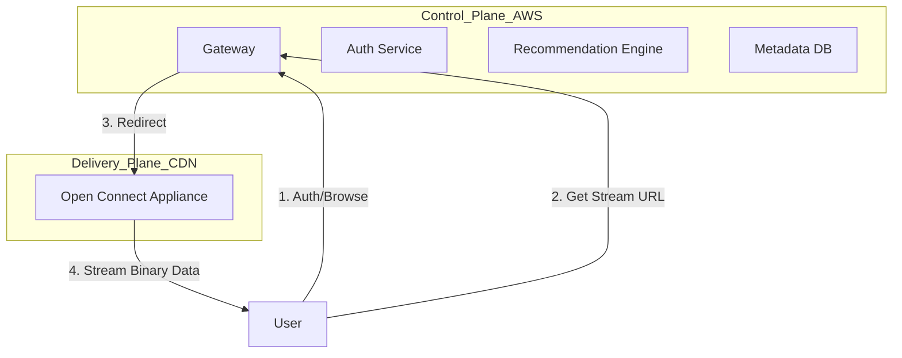

# Problem Breakdown: Designing Netflix (Ultimate Guide)

Netflix is a global streaming service. The primary challenge is delivering high-quality video to 200M+ users with zero buffering, regardless of their network quality or distance from the data center.

---

## 1. Requirements

### Functional Requirements
- **Stream Video**: Users can play movies/shows in various resolutions (4K, HD, SD).
- **Search**: Find content by title, genre, or actor.
- **Personalization**: Recommend content based on viewing history.
- **Watchlist**: Users can save shows for later.

### Non-Functional Requirements
- **Ultra-Low Latency**: Start playback in < 2s.
- **Reliability**: Stream must not stop halfway.
- **Scalability**: Handle massive surges (e.g., a new season of a hit show).
- **Cost Efficiency**: Storing and streaming PBs of data is expensive.

---

## 2. Estimation and Constraints

Assuming **200M Users**:
- **Peak Concurrency**: ~20M users watching simultaneously.
- **Bandwidth**: 5Mbps per HD stream * 20M = **100 Tbps (Terabits per second)**. No single data center can handle this.
- **Storage**: Thousands of titles, each transcoded into 100+ different formats (bitrate/resolution combinations).

---

## 3. High-Level Design: The 3 Pillars

1. **Control Plane (AWS)**: Handles everything except the actual video stream (Signup, Payments, Recommendations, Search).
2. **Data Plane (Transcoding)**: The pipeline that takes raw footage and turns it into streamable chunks.
3. **Delivery Plane (CDN)**: The global network that serves the data to your TV.

---

## 4. Detailed Design: Open Connect (Netflix's Own CDN)

Most companies use Akamai or Cloudflare. Netflix built their own (Open Connect).
- **ISP Partnership**: Netflix places custom servers (appliances) directly *inside* ISPs' data centers for free.
- **How it works**: When you hit "Play," your ISP's local Netflix box serves the data. The data never travels across the public internet "Backbone," saving everyone money and reducing latency.

---

## 5. The Transcoding Pipeline

Netflix doesn't store a "Movie.mp4." They store thousands of "Chunks."
- **Process**:
    1. **Chunking**: Break the 2-hour movie into 5-second segments.
    2. **Parallel Transcoding**: Thousands of workers process these chunks into different bitrates (300kbps to 20Mbps) and formats (VP9, H.264).
    3. **Packaging**: Combine chunks with subtitles and audio tracks.
    4. **Storage**: Final chunks are pushed to the **Open Connect** servers.

---

## 6. Recommendation Engine (Personalization)

Netflix uses a **Lambda Architecture** for recommendations:
- **Batch Layer**: Nightly Hadoop/Spark jobs analyze your entire history.
- **Stream Layer**: Real-time analysis of what you just clicked on.
- **Hybrid**: The results are merged to show "Because you watched X..." and "Trending Now."

---

## 7. Identifying & Resolving Bottlenecks

- **The "New Hit" Surge**: When a new show drops, every CDN box is hit hard.
    - **Fix**: **Pre-staging**. Netflix predicts which shows will be hits and pushes them to the CDN boxes during off-peak hours *before* the show is released.
- **Adaptive Bitrate Streaming (ABR)**: If your Wi-Fi drops, the player doesn't buffer; it intelligently switches to a lower-bitrate chunk (e.g., from 1080p to 480p) mid-stream.

> **Senior Tip**: Mention **Micro-frontends**. Netflix's UI on a Smart TV, a Browser, and a Mobile app are all different. They use a "Server-Side UI" approach where the backend defines the layout, allowing for instant UI updates without app store releases.
