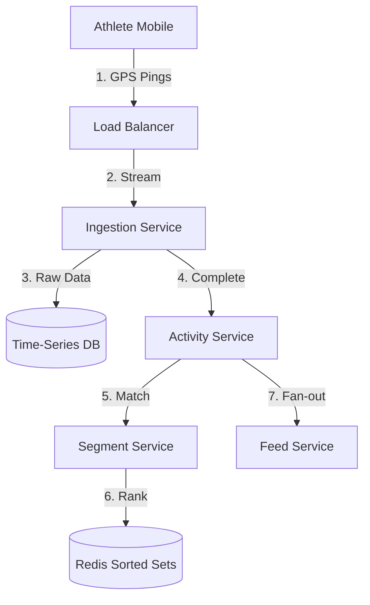

# Problem Breakdown: Designing Strava (Ultimate Guide)

Strava is a social fitness tracking application. The primary challenges are handling high-resolution time-series data (GPS pings), calculating "Segment" leaderboards in real-time, and managing a social feed of high-volume activity data.

---

## 1. Requirements

### Functional Requirements
- **Activity Tracking**: Record duration, distance, and path (GPS points).
- **Segments & Leaderboards**: Automatically detect if an activity crossed a "Segment" and rank the user.
- **Social Feed**: View activities from people you follow, with "Kudos" and comments.
- **Stats Aggregation**: Weekly/Monthly/Yearly totals.

### Non-Functional Requirements
- **High Durability**: Workout data must never be lost.
- **Low Latency**: Feed updates should be fast; leaderboard updates can be eventually consistent.
- **Accuracy**: Precise distance and elevation calculations.
- **Scale**: Handle millions of concurrent GPS streams during peak workout hours.

---

## 2. Estimation and Constraints

Assuming **100M active athletes**:

### Traffic
- **GPS Streams**: 1M concurrent athletes * 1 ping/sec = **1M writes/sec**.
- **Activity Completion**: 5M activities/day ≈ **60 activities per second**.

### Storage
- **GPS Points**: 5M activities * 3600 points (1 hr) * 20 bytes = **360 GB/day**.
- **Processed Maps**: Polylines are smaller, but raw pings add up. Use a TTL for raw pings and keep processed polylines forever.

---

## 3. Data Model Design

### Core Entities
- **Athlete**: `athlete_id, name, bio, total_distance`
- **Activity**: `activity_id, athlete_id, type (Run/Bike), polyline, start_time, duration, distance`
- **Segment**: `segment_id, polyline, start_lat_long, end_lat_long`
- **Leaderboard_Entry**: `segment_id, athlete_id, effort_id, time, rank`

### Database Selection
- **Relational (PostgreSQL)**: Users and Segments (spatial indexing for starts/ends).
- **Time-Series (InfluxDB / TimescaleDB)**: Raw GPS points and heart rate data.
- **In-Memory (Redis Sorted Sets)**: Leaderboards for segments.

---

## 4. High-Level Design

---

## 5. Detailed Design: Segments & Leaderboards

### A. Segment Matching
How do we know if a user ran "The Big Hill"?
1. **Filtering**: When an activity is finished, query the **Segment Service** for segments whose `start` and `end` points are within the activity's bounding box.
2. **Matching**: Compare the activity's polyline against the segment's polyline using the **Douglas-Peucker algorithm** or simple distance thresholds.

### B. Dynamic Leaderboards (Redis ZSET)
For every segment, we maintain a **Sorted Set** in Redis:
- `Key`: `leaderboard:{segment_id}`
- `Member`: `athlete_id`
- `Score`: `time_in_seconds`
Redis automatically keeps these sorted $O(\log N)$, making "Get Rank" and "Get Top 10" extremely fast.

---

## 6. Social Feed (Fan-out)

Similar to the **Facebook News Feed**:
- Most users have < 500 followers. Use **Push-based Fan-out**.
- When an activity is finalized, push its ID into the Redis feed cache of all followers.
- Add "Kudos" using an atomic counter in Redis to avoid DB contention.

---

## 7. Scaling Write-Heavy GPS Ingestion

One ping/sec is too much for a direct DB write.
- **Client-Side Buffering**: The mobile app should buffer 30-60 seconds of GPS data and send it as a single chunk.
- **Stream Processing**: Use **Kafka** to ingest the pings. A consumer group processes the pings (calculating current pace/distance) and flushes them to the Time-Series DB in batches.

---

## 8. Identifying & Resolving Bottlenecks

- **Elevation Correction**: GPS elevation is notoriously inaccurate. Use a background worker to cross-reference GPS points with a **Global Elevation Database** (DEM) to provide accurate "Elevation Gain" stats.
- **Privacy Zones**: Users often hide their home/office address. Before fanning out an activity, any points within a defined "Privacy Circle" must be clipped from the polyline.
- **Leaderboard Sharding**: Popular segments (e.g., Central Park Loop) can have 100k+ entries. Redis handles this well, but if memory becomes an issue, shard leaderboards by `segment_id`.

> **Senior Tip**: Discuss **Polyline Compression**. Use the **Google Encoded Polyline Algorithm** to compress a list of 3,600 lat/long points into a single short string for efficient DB storage and fast frontend rendering.
