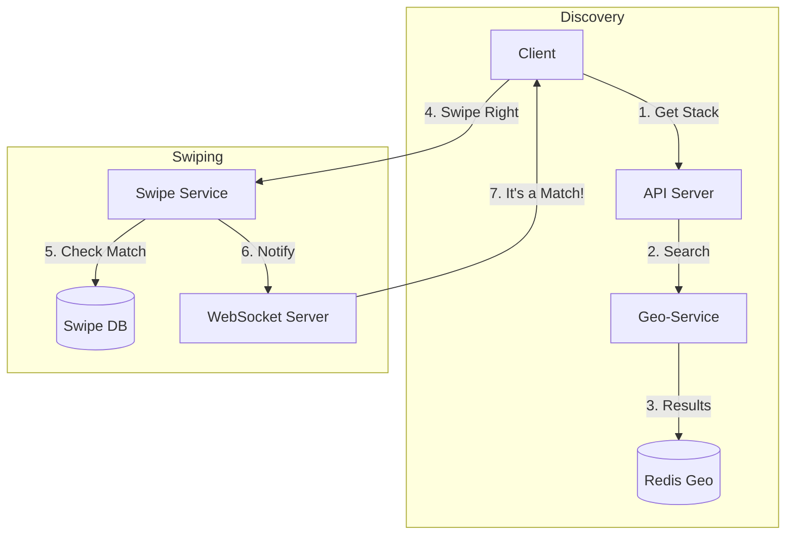

# Problem Breakdown: Designing Tinder (Ultimate Guide)

Tinder is a geospatial dating application. The primary challenges are low-latency proximity discovery (finding people within X miles) and ensuring atomic, real-time "Match" notifications when two users mutually swipe right.

---

## 1. Requirements

### Functional Requirements
- **Profile Creation**: Upload photos and set preferences (Bio, Age, Distance).
- **Discovery**: See a "Stack" of profiles within a specified radius.
- **Swiping**: Left (No) or Right (Yes).
- **Matching**: Real-time notification if two users both swipe right on each other.

### Non-Functional Requirements
- **High Availability**: Users should always be able to swipe.
- **Low Latency**: Profile stacks should load instantly.
- **Scale**: Handle millions of swipes per second and global proximity queries.
- **Smooth UX**: No double-swiping or "Match lag".

---

## 2. Estimation and Constraints

Assuming **50M Monthly Active Users**:

### Traffic
- **Swipes**: 1 Billion swipes per day ≈ **11.5K swipes per second**.
- **Discovery Queries**: 100M per day ≈ **1.1K queries per second**.

### Storage
- **Swipes**: 1B/day * 50 bytes = 50GB/day. 
- **Recommendation Metadata**: 50M users * 1KB data = 50GB.

---

## 3. Data Model Design

### Core Entities
- **User**: `user_id, name, age, gender, preference_radius, last_lat_long`
- **Swipe**: `swiper_id, target_id, type (LIKE/DISLIKE), created_at`
- **Match**: `user_a, user_b, created_at`

### Database Selection
- **Relational (PostgreSQL)**: User data and account settings.
- **NoSQL (Cassandra/DynamoDB)**: Swipe history. This is write-intensive and doesn't need complex relations.
- **Geospatial (Redis GEORADIUS or S2 Geometry)**: Current active locations for the discovery engine.

---

## 4. High-Level Design

---

## 5. Detailed Design: Proximity & Recommendations

### A. Discovery Engine (S2 Cells vs Quadtrees)
- **S2 Cells**: Maps the 3D earth into a 2D line. Every user belongs to a 64-bit cell ID. Finding nearby users is as simple as a range query between cell IDs.
- **The Filter**: When getting a stack, the system must filter out:
    1. People the user has already swiped on.
    2. People who don't fit age/gender preferences.
- **Optimization**: Use a **Bloom Filter** (locally or on the server) to quickly skip people already swiped on without hitting the main Swipe DB for every recommendation.

### B. The Match Logic (Race Conditions)
What if User A and User B swipe right at the exact same millisecond?
1. **Step 1**: User A swipes right. SS checks Swipe DB for `target: A, swiper: B, type: LIKE`.
2. **Step 2**: If found, it's a match.
3. **Prevention**: Use **Atomic Writes** or a **Distributed Lock (Redis)** on the key `match:min(A,B)-max(A,B)` to ensure the match notification is only triggered once.

---

## 6. Scaling User Recommendations

Generating a stack of 50 profiles for every user session is expensive.
- **Pre-computation**: A background worker periodically finds 200 potential matches for every active user based on geo-location and preferences and stores them in a **Recommendation Cache (Redis)**.
- **Ranking**: Use a simple ELO score. Users who get more "Right Swipes" are shown more often. To ensure fairness, inject "New Users" or "Boosted Users" into the stack.

---

## 7. Identifying & Resolving Bottlenecks

- **Ephemeral Presence**: Driver locations are updated every few minutes. Use **Redis with TTLs** for "Active Users." If someone hasn't swiped in 7 days, don't include them in discovery.
- **Notification Scale**: Matches require instant notifications. Use a cluster of **WebSocket Servers** managed by a **Redis Pub/Sub** bus to route messages correctly.
- **Photo Delivery**: Dating is 90% visual. Use a **Global CDN** with image optimization (resizing to phone screen dimensions) to minimize data usage.

> **Senior Tip**: Mention **Geo-Sharding**. Data in London doesn't need to be in New York. Shard the Geo-Service and Swipe DB by country/region to keep physical latency low and comply with data residency laws (GDPR).
