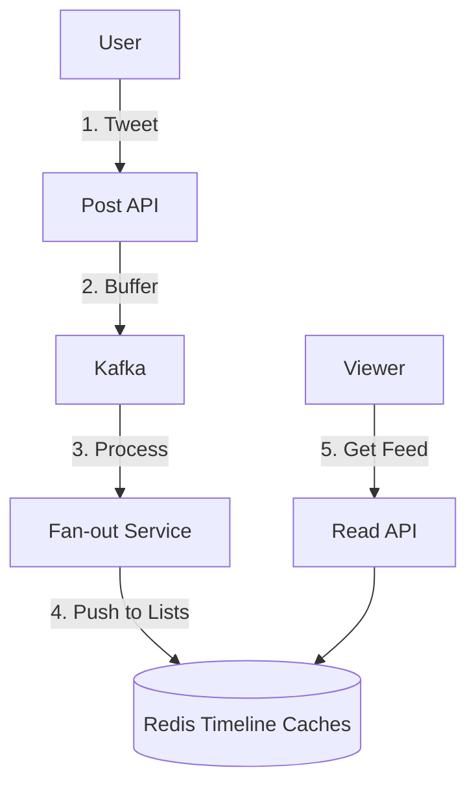

# Problem Breakdown: Designing Twitter (Ultimate Guide)

Twitter is a social media platform where users post short messages (Tweets) and follow others. The primary challenge is the "Fan-out" problem: how to efficiently deliver tweets from celebrities (with 100M+ followers) to their followers' timelines in real-time.

---

## 1. Requirements

### Functional Requirements
- **Post Tweets**: Users can post short text messages.
- **Follow**: Users can follow/unfollow other users.
- **Home Timeline**: View a feed of tweets from people the user follows.
- **Search**: Search for tweets by keywords or hashtags.

### Non-Functional Requirements
- **High Availability**: The feed must be available 24/7.
- **Latency**: Posting a tweet and seeing it on a follower's feed should take < 5s.
- **Read-Heavy**: Millions of users reading timelines vs. thousands posting.
- **Celebrity Support**: Handling users with massive follower counts.

---

## 2. Estimation and Constraints

Assuming **300M Daily Active Users (DAU)**:
- **Tweets**: 500M tweets/day ≈ **6,000 tweets/sec**.
- **Timeline Reads**: 30B reads/day ≈ **350,000 reads/sec**.
- **The Gap**: Reading is ~60x more frequent than writing.

---

## 3. Data Model Design

### Core Entities
- **User**: `user_id, name, bio, tweet_count`
- **Tweet**: `tweet_id, author_id, text, timestamp, media_urls`
- **Following**: `follower_id, followee_id, timestamp`

### Database Selection
- **Relational (PostgreSQL)**: For user profiles and follows.
- **NoSQL (Wide-Column like Cassandra)**: For storing the massive volume of tweets.
- **In-Memory (Redis)**: Essential for storing "Pre-computed Timelines."

---

## 4. High-Level Design: Push vs Pull

The core of Twitter design is the **Timeline Generation Strategy**.

### A. Pull Model (Fan-out on Load)
When a user opens their home feed, the system queries the database for all tweets from everyone they follow and merges them.
- **Pro**: Simple writes.
- **Con**: Extremely slow reads for users with many "follows."

### B. Push Model (Fan-out on Write)
When a user posts a tweet, the system immediately "pushes" that tweet into the pre-computed timeline caches (Redis) of all their followers.
- **Pro**: Ultra-fast reads (just fetch the Redis list).
- **Con**: "Celebrity Problem." If a user with 100M followers tweets, the system has to perform 100M Redis writes instantly.

### C. Hybrid Model (The Winner)
- **Standard Users**: Use the **Push Model**.
- **Celebrities (High Follower Count)**: Use the **Pull Model**. 
- When a user views their feed, they pull the pre-computed timeline (from standard users) and "mix in" the latest tweets from the celebrities they follow.

---

## 5. Detailed Design: The Follower Graph

The "Who follows whom" graph is massive and needs to be sharded.
- **Strategy**: Shard by `follower_id`. This ensures that for any user, you can find everyone they follow on a single database shard.

---

## 6. Identifying & Resolving Bottlenecks

- **Global Hot Spots**: Viral hashtags or events (e.g., World Cup) can overwhelm specific shards.
    - **Fix**: Use an **Aggregator Service** to detect trending topics and cache them in a global CDN/Edge location.
- **Memory Costs**: Keeping 300M timelines in Redis is expensive.
    - **Fix**: Only store timelines for **Active Users** (those who have logged in within the last 30 days). Cold-start the timeline for inactive users when they return.

> **Senior Tip**: Mention **Snowflake ID Generation**. Since we are at such a scale, standard auto-incrementing IDs won't work across shards. Use a distributed ID generator (like Twitter's Snowflake) to create 64-bit, time-ordered, unique IDs.
