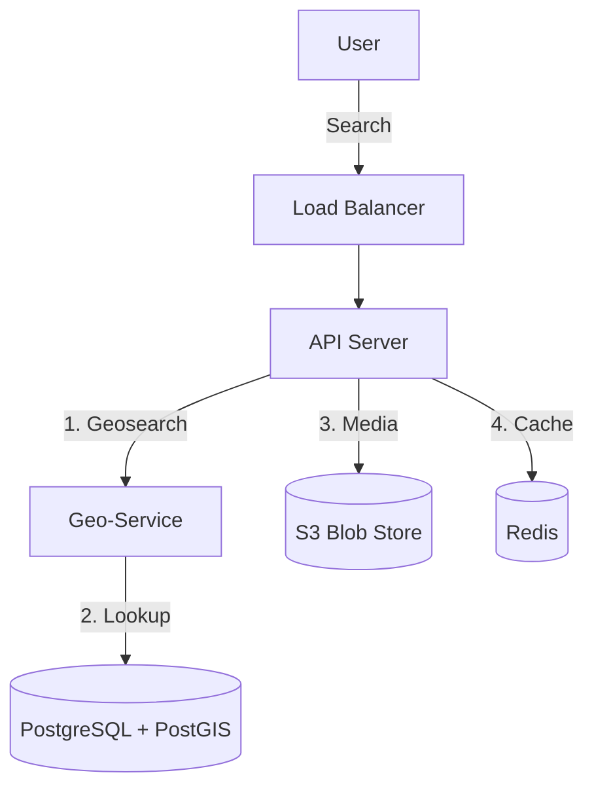

# Problem Breakdown: Designing Yelp (Ultimate Guide)

Yelp is a proximity-based business search and review platform. The core challenge is efficiently indexing millions of businesses by location and supporting high-read traffic for reviews and star ratings.

---

## 1. Requirements

### Functional Requirements
- **Business Search**: Find restaurants, bars, etc., within a certain distance.
- **Reviews & Ratings**: Users can leave text reviews and 1-5 star ratings.
- **Business Profiles**: Owners can upload photos and details (hours, menu).
- **Search Filtering**: Filter by category, price, or "Open Now."

### Non-Functional Requirements
- **High Availability**: Browsing and searching must be sub-second and always online.
- **Consistency**: Star ratings should be eventually consistent (updated every few minutes is fine).
- **Scalability**: Support millions of businesses and billions of reviews.

---

## 2. Estimation and Constraints

Assuming **100M Monthly Active Users**:

### Traffic
- **Search Queries**: 100M/month ≈ **40 Queries per second**. (Read heavy).
- **Reviews**: 1M reviews/month ≈ **0.4 Writes per second**. (Write light).

### Storage
- **Business Metadata**: 10M businesses * 1KB = 10GB.
- **Reviews**: 1B reviews * 2KB = 2 TB.
- **Photos**: 100M photos * 500KB = 50 TB.

---

## 3. Data Model Design

### Core Entities
- **Business**: `business_id (PK), name, address, lat, long, category_id, star_rating`
- **Review**: `review_id, user_id, business_id, rating (1-5), text, created_at`
- **Photo**: `photo_id, business_id, s3_url`

### Database Selection
- **Relational (PostgreSQL)**: Perfect for the rigid schema of Business metadata and Reviews. PostgreSQL also has **PostGIS** for advanced geospatial queries.
- **Blob Storage (S3)**: For business photos and menu PDFs.

---

## 4. High-Level Design

---

## 5. Detailed Design: Proximity Search

### A. Geohashing
Divide the world into a grid. Each cell has a hash (e.g., `9q8yy`). 
- Longer hash = smaller cell.
- Businesses are indexed by their Geohash. 
- To find nearby places, the system finds the user's geohash and queries the database for all matching business prefixes.

### B. Quadtrees
A 2D tree where each node has up to 4 children.
- If a node has too many businesses (e.g., Manhattan), it "splits" into 4 sub-nodes.
- If a node is mostly empty (e.g., a desert), it stays as one node.
- **Advantage**: Dynamically balances the load based on business density.

---

## 6. Review Aggregation (The Star Problem)

We shouldn't calculate the average star rating on Every Search (`SELECT AVG(rating) FROM reviews...` is $O(N)$).
- **Solution**: Denormalize. Store `total_stars` and `review_count` in the `Business` table.
- **Update Frequency**: When a review is posted, use a **Background Worker** to update these counts asynchronously. The search results will show the cached average.

---

## 7. Performance & High Availability

- **Search Cache**: Cache the results of common searches (e.g., "Sushi in San Francisco") in **Redis** for 1 hour.
- **Read Replicas**: Since Yelp is 99% reads, use one Primary DB for writes (new reviews) and 5-10 Read Replicas for search queries.
- **CDN**: Use a CDN to serve business photos.

---

## 8. Identifying & Resolving Bottlenecks

- **Static Data Growth**: Businesses don't change locations often. We can store the entire "Geo-Index" in memory (Redis or custom Trie) to make searches near $O(1)$.
- **Inaccurate Counts**: If the background worker fails, the star rating might be wrong. Periodically run a "Correction Job" (Reconciliation) to recalculate averages from raw review data.

> **Senior Tip**: Mention **Elasticsearch**. For complex filters (Price: $$, Tags: "Vegan", Status: "Open Now"), a specialized search engine like Elasticsearch is much faster than standard SQL for faceted searching.
