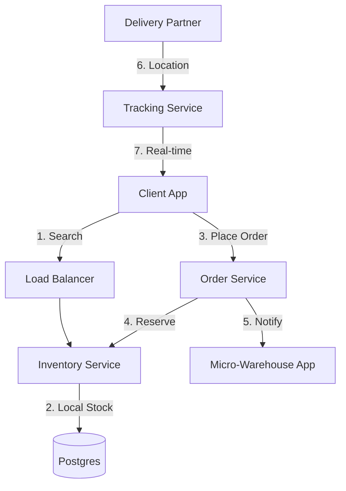

# Problem Breakdown: Designing Gopuff (Local Delivery)

Gopuff is an instant-needs delivery service that owns its own inventory and micro-fulfillment centers (MFCs). Unlike UberEats (which partners with restaurants), the core challenge is real-time inventory synchronization across thousands of small warehouses and coordinating 15-minute delivery windows.

---

## 1. Requirements

### Functional Requirements
- **Browse Inventory**: View products available in the user's nearest micro-warehouse.
- **Order Placement**: Add to cart and pay.
- **Order Tracking**: Real-time status from "Picking" to "Out for Delivery".
- **Dynamic Fulfillment**: Match orders with available delivery partners at specific warehouses.

### Non-Functional Requirements
- **Strong Consistency (Inventory)**: Do not allow ordering an item that went out of stock 10 seconds ago.
- **Low Latency**: Near-instant updates for delivery location.
- **High Availability**: Service must work 24/7 across multiple time zones.
- **Scalability**: Handle thousands of simultaneous orders per city.

---

## 2. Estimation and Constraints

Assuming **10M Monthly Active Users** and **2,000 MFCs**:

### Traffic
- **Orders**: 500k orders/day ≈ **6 orders per second**.
- **Inventory Updates**: Thousands of items per warehouse being picked or restocked.

### Storage
- **Inventory DB**: 2,000 warehouses * 5,000 items = 10M rows.
- **Tracking Logs**: High-frequency location pings for the delivery fleet.

---

## 3. Data Model Design

### Core Entities
- **Warehouse (MFC)**: `warehouse_id, location, boundary_polygon`
- **Product**: `product_id, name, description, category`
- **Inventory**: `warehouse_id, product_id, current_stock_count, reserved_count`
- **Order**: `order_id, warehouse_id, user_id, status (PREPARING, READY, PICKED_UP, DELIVERED)`

### Database Selection
- **Relational (PostgreSQL)**: Mandatory for inventory and transactional consistency.
- **NoSQL (Cassandra)**: Excellent for order history and location logs.
- **In-Memory (Redis)**: For real-time delivery status and "Hot" inventory availability.

---

## 4. High-Level Design

---

## 5. Detailed Design: Real-time Inventory

Preventing "Over-selling" is the biggest hurdle.
- **Two-Phase Reservation**:
    1. When a user adds to cart, the system checks `current_stock_count`.
    2. It places a **Soft Reservation** (`reserved_count++`) for 5 minutes.
    3. If the order is paid, `current_stock_count--` and `reserved_count--`.
    4. If not paid, the soft reservation expires and `reserved_count--`.
- **Concurrency**: Use **Optimistic Locking** or **Row-level Locks** in PostgreSQL to ensure stock counts don't go negative during simultaneous orders.

---

## 6. Pickup & Delivery Coordination

Gopuff drivers stay at or return to the warehouse (unlike Uber drivers who roam).
- **The "Dispatcher" logic**:
    - Orders are pooled by the **Dispatcher Service**.
    - When a driver is back at the warehouse, the most efficient "Batch" of orders (e.g., 3 orders in the same direction) is assigned.
- **Route Optimization**: Use the **Traveling Salesperson (TSP)** algorithm to sequence the 3 stops for the driver.

---

## 7. Scaling the Catalog

Every warehouse has a different catalog.
- **Geographic Sharding**: Shard the Inventory Service by `warehouse_id`. This localizes the load and ensures that a spike in NYC doesn't affect Fresno.
- **Search Caching**: Cache the "Available Product List" for a warehouse in **Redis** with a short TTL (60s). This offloads the heavy JOINs between `Product` and `Inventory` tables.

---

## 8. Identifying & Resolving Bottlenecks

- **The "Ghost" Inventory**: Sometimes a picker can't find an item that the system says is in stock.
    - **Fix**: The Picker App has a "Not Found" button. This triggers an immediate **Manual Reconciliation** and updates the customer's order (Refund/Swap).
- **Scale of Location Pings**: 100k drivers pinging every 5 seconds.
    - **Fix**: Use **gRPC or WebSockets** to reduce header overhead compared to REST. Move the location data to a fast NoSQL store (DynamoDB/Cassandra).

> **Senior Tip**: Mention **Last-Mile Predictive Analytics**. Use historical data to predict which items will sell out in which MFC. Automatically generate "Restock Orders" for the larger central distribution centers before the MFC actually hits zero.
