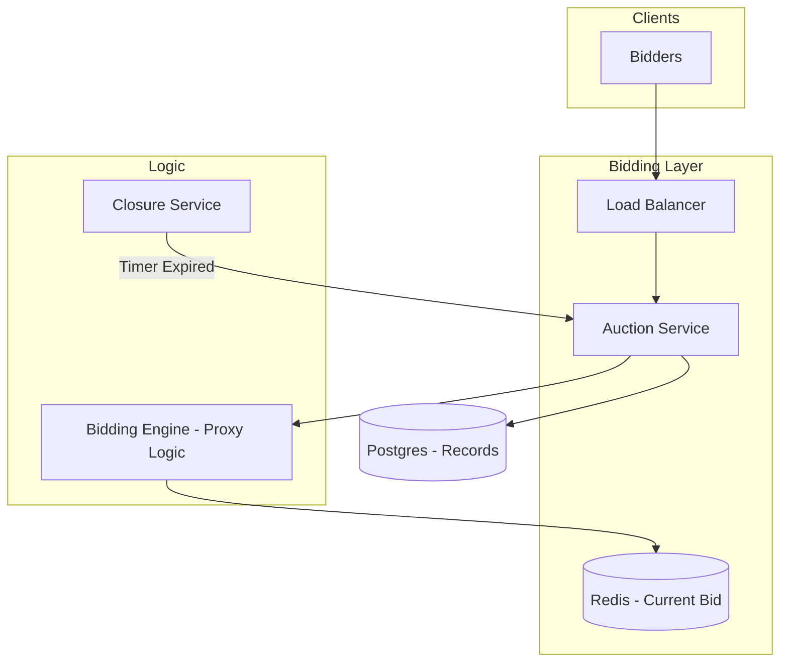

# Problem Breakdown: Designing an Online Auction (Ultimate Guide)

An online auction system (like eBay) allows users to bid on items over a set period. The primary challenge is handling extreme concurrency in the final seconds of an auction and ensuring the "Highest Bidder" is determined accurately and fairly.

---

## 1. Requirements

### Functional Requirements
- **List Items**: Sellers can list items with a starting price and end time.
- **Place Bids**: Bidders can place a bid higher than the current price.
- **Proxy Bidding**: Auto-bid up to a user's maximum price.
- **Real-time Updates**: Bidders see new highest bids instantly.
- **Auction Closure**: Automatically finalize the winner when time expires.

### Non-Functional Requirements
- **High Consistency**: The "Current Price" and "Winner" must be 100% accurate.
- **Low Latency**: Bids must be processed and acknowledged in < 50ms.
- **Fairness**: Precisely handle simultaneous bids in the final seconds ("Sniping").
- **Scalability**: Support millions of concurrent auctions.

---

## 2. Estimation and Constraints

Assuming **1M active auctions** and **Peak Traffic**:
- **Bids**: 10,000 bids/sec (During the final seconds of popular auctions).
- **Reads**: 100K queries/sec as people watch the clock.

---

## 3. Data Model Design

### Core Entities
- **Auction**: `auction_id, seller_id, start_price, current_price, highest_bidder_id, end_time, status (OPEN, CLOSED)`
- **Bid**: `bid_id, auction_id, bidder_id, amount, timestamp`

### Database Selection
- **Relational (PostgreSQL)**: Essential for the final auction state and payment processing.
- **In-Memory (Redis)**: The "Hot" auction state (Current Price, Highest Bidder) must be in Redis for $O(1)$ updates and sub-millisecond latency.

---

## 4. High-Level Design

---

## 5. Detailed Design: The "Last Second" Problem

In the final seconds, thousands of people might bid simultaneously. 
- **The Solution**: Use **Redis Lua Scripts**.
- **Process**:
    1. Check if `bid_amount > current_price` and `NOW() < end_time`.
    2. If yes, update `current_price` and `highest_bidder`.
    3. Return Success.
- This ensures that only the first bid that hits Redis at a certain price level is accepted, and all logic is atomic.

---

## 6. Proxy Bidding Logic (Automatic Bidding)

Users can set a "Max Bid" of $500. If the current price is $100 and someone bids $110, the system automatically bids $115 for the first user.
- **Implementation**:
    - When a new bid comes in, the **Bidding Engine** checks if there's a higher "Max Bid" stored (only visible to the system).
    - It automatically places an incremental bid on behalf of the Max Bidder.
    - This can cycle until the new bid exceeds the max or the proxy wins.

---

## 7. Real-time Updates (Watchers)

- **Mechanism**: Use **WebSockets**.
- **Efficiency**: When a new highest bid is accepted, publish a message to a **Redis Pub/Sub** topic: `auction:123`.
- **Fan-out**: All WebSocket servers watching `auction:123` push the update to their connected clients. This provides the "Live" feel crucial for auctions.

---

## 8. Identifying & Resolving Bottlenecks

- **Auction Closure Race**: If a bid comes in at 11:59:59.999 while the "Closure Service" is running.
    - **Fix**: The Closure Service must obtain a **Distributed Lock** on the Auction ID in Redis before finalizing the DB record. Any bids that hit after the lock is acquired are rejected.
- **Database Write Load**: Don't write every single bid to PostgreSQL instantly. 
    - **Optimization**: Log bids to **Kafka** first. A background worker periodically flushes the final state to the Relational DB. Redis holds the authoritative "current" state.
- **Sniping Protection**: Some auctions implement "Dynamic Ending" (e.g., if a bid is placed in the last 30 seconds, the end time is extended by 1 minute). This reduces stress on the system and increases revenue.

> **Senior Tip**: Mention **NTP (Network Time Protocol)**. To ensure "Fairness," all Auction Servers across all data centers must have perfectly synchronized clocks. A 10ms drift could mean a valid bid is rejected as "too late."
