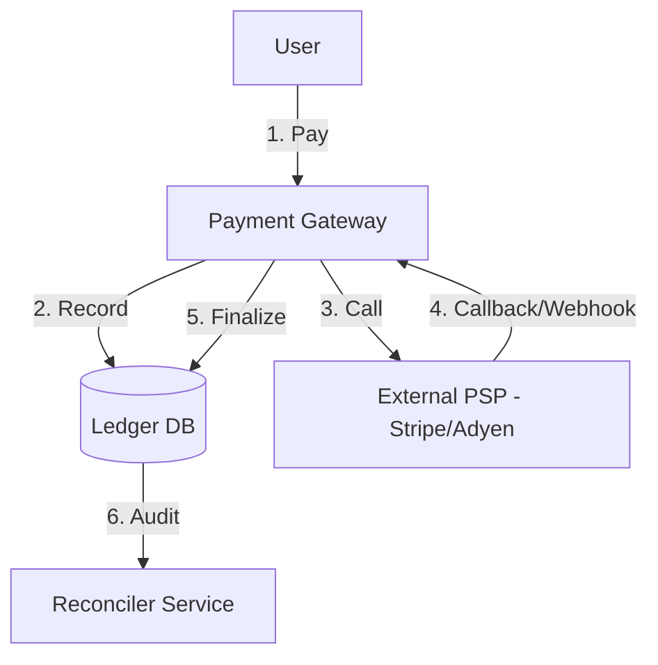

# Problem Breakdown: Designing a Payment System (Ultimate Guide)

A payment system (like Stripe or PayPal) must be the most reliable part of any infrastructure. The primary challenges are ensuring 100% data consistency, preventing double charging (idempotency), and maintaining a flawless "Audit Trail" (Ledger).

---

## 1. Requirements

### Functional Requirements
- **Execute Payment**: Process a transaction from User A to User B.
- **Refunds**: Return funds for a previous transaction.
- **Ledger/Balance**: View current balance and transaction history.
- **Reconciliation**: Ensure internal records match external bank/PSP bank statements.

### Non-Functional Requirements
- **Strong Consistency**: Balances must always be accurate. No race conditions.
- **Durability**: Every transaction must be recorded in an immutable log.
- **High Availability**: The system should accept payments even if the internal ledger is under heavy load.
- **Security**: PCI-DSS compliance, encryption, and fraud detection.

---

## 2. Estimation and Constraints

Assuming **10,000 Transactions Per Second (TPS)**:
- **Writes**: 10k TPS to the Transaction Log. 
- **Reconciliation**: Processing 864 Million transactions per day for daily audits.

---

## 3. Data Model Design: The Ledger Pattern

Never store balance as just a number `balance = 500`. This is prone to race conditions.
- **Solution**: **Double-Entry Accounting (Immutable Ledger)**.
- **Ledger Table**: `id, account_id, amount, type (DEBIT/CREDIT), transaction_id, created_at`.
- **Logic**: A user's balance is the `SUM(amount)` of all their ledger entries. (In practice, we use a "Snapshot" table for speed).

### Database Selection
- **Relational (PostgreSQL)**: Mandatory for ACID compliance and strictly enforced schemas.
- **Compliance Store**: Archived logs for 7+ years (S3/Glacier).

---

## 4. High-Level Design

---

## 5. Detailed Design: Ensuring Reliability

### A. Idempotency (The Idempotency Key)
What if the network drops *after* the bank takes the money but *before* the server knows?
1. Client generates a unique `idempotency_key` for the request.
2. Server checks if `key` exists in Redis/DB.
3. If yes, it returns the previous response immediately.
4. If no, it creates a "Pending" record and proceeds with the payment.

### B. The State Machine
Every payment follows a strictly defined flow:
`CREATED -> PENDING -> AUTHORIZED -> CAPTURED (Success) or FAILED`.
- The system must transition between these states using atomic DB transactions.

---

## 6. Reconciliation (Level 1 & 2)

Reconciliation is the process of verifying your internal truth against the external world.
- **Internal (L1)**: Check if `Ledger Total == Account Balance`.
- **External (L2)**: Daily, download a CSV from the bank/PSP and compare every `psp_transaction_id` against your `internal_transaction_id`.
- **Discrepancy Resolution**: Flag any mismatch for human review or automated corrective entries.

---

## 7. Scaling Transaction Volume

- **Message Queues**: Don't update the Ledger synchronously with the external bank call.
    1. Gateway receives request.
    2. Writes "Pending" to DB.
    3. Pushes to Kafka.
    4. Worker handles the slow external network call and updates the status later.
- **DB Sharding**: Shard the ledger by `account_id` to distribute the massive write-load.

---

## 8. Identifying & Resolving Bottlenecks

- **Database Locking**: Updating a "Hot Account" (e.g., a popular merchant) can cause row locks.
    - **Fix**: **Buffered Writes**. Collect 100 payments for the merchant and write them to the ledger as a single batch update every 1 second.
- **PSP Downtime**: If Stripe is down, the system should log the intent to pay and retry with exponential backoff once the PSP returns.

> **Senior Tip**: Mention **Distributed Transactions & Sagas**. If you need to deduct from a Wallet and update an Order DB, use the **Saga Pattern** (orchestrated or choreographed) to ensure that either both succeed or a "Compensating Transaction" reverts the first one if the second fails.
