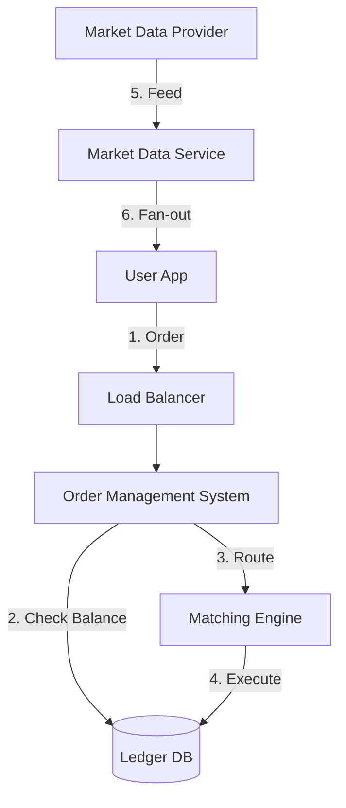

# Problem Breakdown: Designing Robinhood (Ultimate Guide)

Robinhood is a stock and crypto trading platform. The primary challenges are handling real-time market data at scale, executing trades with ultra-low latency, and maintaining 100% accurate ledgers for user balances and stock positions.

---

## 1. Requirements

### Functional Requirements
- **Place Orders**: Support Market, Limit, and Stop orders.
- **Stock Quotes**: View real-time price feeds for tickers.
- **Portfolio Management**: View positions, profit/loss, and history.
- **Watchlists**: Real-time updates on a select group of stocks.

### Non-Functional Requirements
- **Ultra-Low Latency**: Order execution must be sub-millisecond.
- **Strong Consistency**: Buying power and stock balance must be 100% accurate.
- **High Availability**: Market hours are critical; the system must not go down.
- **Security & Compliance**: SEC/FINRA audit requirements and anti-fraud.

---

## 2. Estimation and Constraints

Assuming **20M Daily Active Users**:

### Traffic
- **Orders**: 2M orders/day ≈ **25 orders/sec** (bursts of 10k during market open).
- **Price Pings**: Thousands of tickers updating every 100ms ≈ **100k+ updates/sec**.

### Storage
- **Trade History**: 2M trades/day * 1KB = 2GB/day.
- **Market Data**: TBs of raw market pings (usually archived to data lakes).

---

## 3. Data Model Design

### Core Entities
- **Account**: `account_id, cash_balance, buying_power, margin_status`
- **Position**: `account_id, ticker_id, quantity, avg_cost`
- **Order**: `order_id, account_id, ticker_id, type (Limit/Market), side (Buy/Sell), status (New, Filled, Rejected), price, quantity`
- **Trade**: `trade_id, order_id, execution_price, quantity, timestamp`

### Database Selection
- **Relational (PostgreSQL)**: Absolutely mandatory for User Balances and Positions. Use a "Ledger" approach (see Payment System) for account movements.
- **In-Memory (Redis/In-Memory Engine)**: The **Order Book** for the Matching Engine must be in-memory for speed.

---

## 4. High-Level Design

---

## 5. Detailed Design: The Matching Engine

The core of any trading app.
1. **The Order Book**: A list of Bids (Buy) and Asks (Sell) for a ticker, sorted by Price, then Time (Price-Time Priority).
2. **Matching Process**:
    - When a new Buy order comes in at $150, the engine checks the top of the Sell list.
    - If Sell Price <= $150, a **Trade** is generated.
    - If not, the order is added to the Bid side of the book.
3. **Architecture**: Usually implemented in **C++ or Rust** for predictable latency, with data sharded by Ticker.

---

## 6. Scaling Market Data (Fan-out)

Prices change 10x per second. You cannot query a DB for this.
- **Mechanism**: Use **WebSockets** for a persistent connection.
- **Distribution**: 
    1. MDS receives data from NMS/Nasdaq.
    2. MDS publishes to **Redis Pub/Sub** or **Kafka**.
    3. WebSocket servers subscribe to tickers their connected clients are watching.
- **Throttling**: Don't send every 1ms update to the client. Batch updates every 100-200ms to save mobile battery and network load.

---

## 7. Buying Power Calculation

Before an order hits the matching engine, you must verify the user can afford it.
- **Challenge**: Buying power is dynamic (Cash + Margin - Open Orders).
- **Optimization**: Store "Current Buying Power" in **Redis**. 
    - When an order is placed, use a **Lua Script** to subtract the estimated cost.
    - If successful, proceed to the OMS.
    - If the order is cancelled or filled at a lower price, the difference is added back.

---

## 8. Identifying & Resolving Bottlenecks

- **Order Integrity**: Use a **Transactional Saga** if the matching engine and ledger are separate services. Ensuring a "Filled" order results in a "Balance Deduction" is the highest priority.
- **Hot Tickers**: Highly volatile stocks ($GME, $TSLA) can overwhelm a single matching engine shard.
    - **Fix**: Shard the matching engine by ticker. High-volume tickers get their own dedicated CPU/Server.
- **Audit Logging**: Every single event (Order Submitted, Rejected, Routed, Filled) must be logged to a **Write-Ahead Log (WAL)** or a dedicated Audit DB for regulatory compliance.

> **Senior Tip**: Mention **Idempotency** for order placement. If a user double-clicks "Buy", the client should tag both requests with the same UUID. The server will reject the second request, preventing accidental double-buying.
