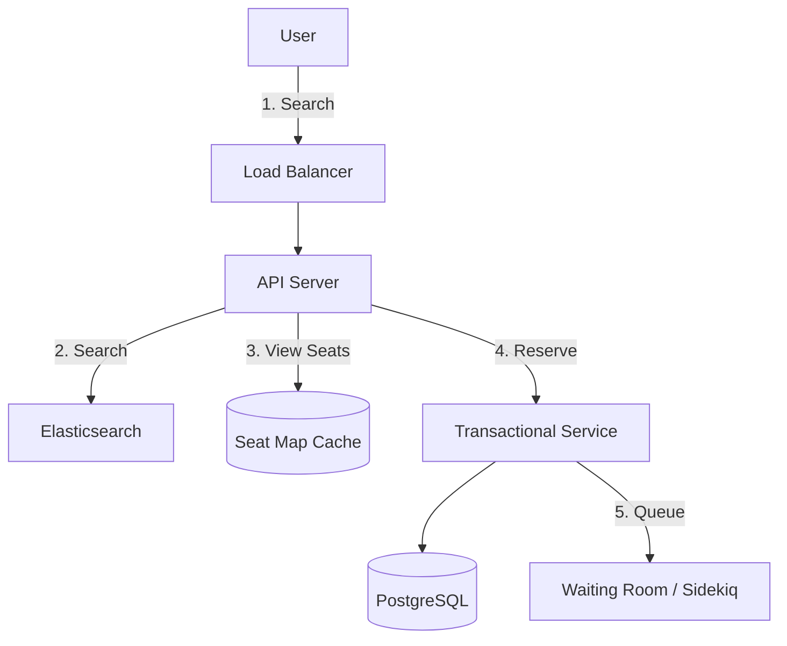

# Problem Breakdown: Designing Ticketmaster (Ultimate Guide)

Ticketmaster is a high-concurrency event ticketing platform. The core challenges are managing inventory with 100% accuracy, handling massive "thundering herd" spikes during ticket drops, and preventing double-booking through distributed locking.

---

## 1. Requirements

### Functional Requirements
- **Search Events**: Users can search for events by name, city, or date.
- **Seat Map**: View available seats for a specific venue.
- **Ticket Reservation**: Hold a seat for 10 minutes while the user pays.
- **Purchase**: Finalize the booking and issue a digital ticket.

### Non-Functional Requirements
- **High Consistency**: No seat can ever be double-booked.
- **High Availability**: Search and browsing must remain available even during peak drops.
- **Scalability**: Handle 1M+ concurrent users during a major tour sale (e.g., Taylor Swift).
- **Fairness**: Prevent bot-scraping and ensure a fair "first-come, first-served" experience.

---

## 2. Estimation and Constraints

Assuming a **Popular Concert Drop**:
- **Peak Traffic**: 5M users hitting the site at 10:00 AM.
- **Inventory**: 50,000 seats per venue.
- **RPS**: 100K requests/second on the search and seat-map APIs.

---

## 3. Data Model Design

### Core Entities
- **Event**: `event_id, title, venue_id, date`
- **Venue**: `venue_id, name, location, capacity`
- **Seat**: `seat_id, venue_id, row, number, type`
- **Ticket**: `ticket_id, event_id, seat_id, status (AVAILABLE, RESERVED, BOOKED), price, lock_expiry_time`

### Database Selection
- **Relational (PostgreSQL)**: Transactional integrity is mandatory here. PostgreSQL's `SELECT FOR UPDATE` or serializable isolation levels ensure no two users can reserve the same seat.
- **Search Engine (Elasticsearch)**: For fast, fuzzy searching of millions of events globally.

---

## 4. High-Level Design



---

## 5. Detailed Design: The Reservation Lock

### A. The "Implicit Status" Pattern
Don't just set a status to "RESERVED". You need a way to automatically expire it without a heavy cron job.
1. **The Row**: `status: RESERVED, reserved_at: 10:00:00, expires_at: 10:10:00`.
2. **The Logic**: A seat is "Available" if:
    - `status == AVAILABLE` OR
    - `status == RESERVED AND NOW() > expires_at`.
3. **The Transaction**:
   ```sql
   BEGIN;
   UPDATE tickets SET status = 'RESERVED', expires_at = NOW() + INTERVAL '10 min'
   WHERE ticket_id = 123 AND (status = 'AVAILABLE' OR expires_at < NOW());
   COMMIT;
   ```

### B. Virtual Waiting Room (The Queue)
During massive spikes, hitting the DB directly will crash it.
- **Solution**: Use a **Token-based Virtual Queue** (e.g., Cloudflare Waiting Room).
- **Process**: Users are given a position in line and a unique `queue_token`. Only X users per second are allowed to proceed to the seat selection page. This "levels" the traffic hitting the backend.

---

## 6. Scaling the Seat Map

For a stadium with 50,000 seats, sending the full status of every seat on every refresh is too much.
- **Solution**: Use **WebSockets** or **Server-Sent Events (SSE)**.
- **Mechanism**: The client loads the initial map. The server pushes "Delta Updates" (e.g., "Seat 45A just changed to Reserved") to all connected clients.
- **Cache**: Store the "Availability Map" (a bitset of 50k bits) in **Redis** for sub-millisecond lookups.

---

## 7. Identifying & Resolving Bottlenecks

- **Database Contentions**: If 1,000 people try for the "Front Row" at the same time, the DB row-lock will slow down.
    - **Fix**: Use **Distributed Locking (Redis/Redlock)** at the application layer *before* hitting the DB. 
- **Bot Mitigation**: Use CAPTCHAs and per-IP/per-Account rate limits for the `reserveSeat` API to prevent scalpers from vacuuming inventory.

---

## 8. Financial Reconciliation

- **Problem**: What if the user pays but the DB update fails?
- **Solution**: The **Ledger Pattern**. Every payment event is logged to an immutable "Ledger" table first. A background job (Reconciler) constantly checks the Ledger against the Ticket table to ensure every "Paid" entry has a corresponding "Booked" ticket.

> **Senior Tip**: Mention **Idempotency Keys**. The `purchaseTicket` API must accept an `idempotency_key` (usually a UUID generated by the client). If the client retries a failed request, the server checks the key and ensures the user isn't charged twice for the same transaction.
