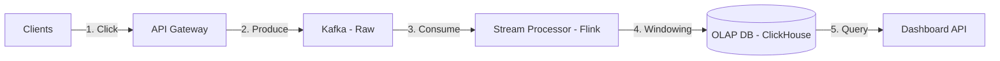

# Problem Breakdown: Designing an Ad Click Aggregator (Ultimate Guide)

Ad Click Aggregators process massive streams of click data to provide real-time analytics for advertisers and billing services. The primary challenges are handling 10k+ events/sec, ensuring "Exactly-Once" processing, and providing sub-second query latency on petabytes of data.

---

## 1. Requirements

### Functional Requirements
- **Click Tracking**: Receive click events from millions of clients.
- **Aggregation**: Aggregate clicks by `AdID` and `Minute/Hour/Day`.
- **Querying**: Advertisers can view performance metrics (CTR, total clicks) in a dashboard.
- **Deduplication**: Prevent duplicate clicks from being counted multiple times.

### Non-Functional Requirements
- **Scalability**: Handle 100k+ clicks/sec during peak periods.
- **Fault Tolerance**: No click data should ever be lost (billing depends on it).
- **Consistency**: Final counts must be accurate (Exactly-Once semantics).
- **Low Latency**: Dashboard queries should be sub-second.

---

## 2. Estimation and Constraints

Assuming **10,000 Clicks Per Second**:
- **Daily Events**: 864 Million clicks/day.
- **Storage**: 864M events * 200 bytes ≈ **170 GB/day** raw.
- **Aggregated Data**: Summing items per minute reduces data size by ~1000x for historical storage.

---

## 3. Data Model Design

### Core Entities
- **Click_Event (Raw)**: `click_id, ad_id, user_id, timestamp, ip, user_agent`
- **Ad_Stats (Aggregated)**: `ad_id, time_bucket (minute), click_count, unique_user_count`

### Database Selection
- **Stream Ingestion (Kafka)**: The buffer for high-throughput raw pings.
- **OLAP Database (ClickHouse / Druid / StarRocks)**: Optimized for "Aggregation on the fly" and massive columnar scans.
- **Key-Value Store (Redis)**: For real-time "Today's Clicks" dashboard counters.

---

## 4. High-Level Design

---

## 5. Detailed Design: Exactly-Once Processing

How do we ensure a click is counted exactly once, even if a worker crashes?
1. **Idempotent Ingestion**: Every click is tagged with a `request_id`.
2. **Checkpointing (Flink/Spark)**: The stream processor regularly saves its state (offsets and partial counts) to HDFS/S3.
3. **Transactional Writes**: Use a "Transactional Producer" in Kafka or "Idempotent Inserts" in the OLAP DB to ensure that if a worker retries, it doesn't create duplicate rows.

---

## 6. Aggregation Strategies

### A. Real-time Aggregation (Stream Processing)
Use **Sliding Windows** or **Tumbling Windows** in Apache Flink.
- Counts are kept in-memory for 1 minute, then "flushed" to the OLAP DB.
- **Pro**: Extremely fast dashboard updates.
- **Con**: High memory overhead for large state.

### B. Lambda Architecture
- **Speed Layer**: Real-time approximation for dashboards.
- **Batch Layer**: Nightly HDFS job (Hive/Spark) to calculate the "Official" billing total with 100% accuracy.

---

## 7. Scaling & Deduplication

- **Bot Detection**: 50% of ad clicks are often bots. Use a **Flink ML Job** to detect patterns (e.g., 100 clicks/sec from one IP) and flag them before they hit the billing DB.
- **Bloom Filters**: Keep a Bloom Filter of `user_id + ad_id + hour` in **Redis** to quickly drop duplicate clicks from the same user within the same hour.

---

## 8. Identifying & Resolving Bottlenecks

- **Kafka Partitioning**: Shard Kafka by `AdID`. This ensures that all clicks for one ad go to the same Flink worker, simplifying local aggregation.
- **Hot Ads**: A viral ad can overwhelm a single partition. 
    - **Fix**: Use two-stage aggregation. First, aggregate partially by a combination of `AdID + RandomShardID`, then do a final global sum.
- **Late Arriving Data**: Some mobile pings arrive 10 minutes late due to poor network. 
    - **Fix**: Use **Watermarks** in Flink to allow a "Grace Period" for late data before closing a time window.

> **Senior Tip**: Discuss **Cost-Efficiency**. Storing raw clicks in ClickHouse for 1 year is expensive. Implement a **Tiered Storage Strategy**: Raw data for 7 days -> Minute-level aggregates for 3 months -> Day-level aggregates for 5 years.
