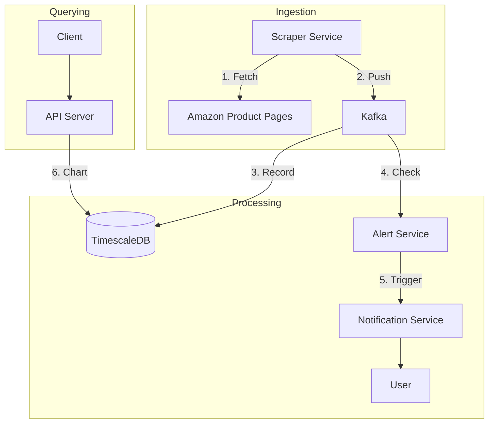

# Problem Breakdown: Designing CamelCamelCamel (Price Tracker)

CamelCamelCamel is a price tracking tool for Amazon products. The primary challenges are building a massive-scale scraper that avoids being blocked, storing billions of historical price points (Time-Series), and triggering real-time alerts when a price "drops" below a user's threshold.

---

## 1. Requirements

### Functional Requirements
- **Price History**: View a chart of a product's price over time.
- **Price Alerts**: Notify users via email/push when a price hits their target.
- **Scraping**: Periodically fetch prices for millions of products.
- **Top Drops**: Show products with the biggest recent price decreases.

### Non-Functional Requirements
- **High Durability**: Price history is the main value; it must not be lost.
- **Scale**: Monitor 10M+ unique products.
- **Integrity**: Ensure the scraped price is accurate (handling coupons, shipping, etc).
- **Update Latency**: Price drops should be detected within 1-2 hours of the change.

---

## 2. Estimation and Constraints

Assuming **10 Million Products**:
- **Updates**: Every product is checked 4x per day = **40M trackings/day** ≈ **460 requests/sec**.
- **Historical Data**: 10M products * 1,000 price points (3 years) = **10 Billion data points**.

---

## 3. Data Model Design

### Core Entities
- **Product**: `product_id, title, url, thumbnail_url, current_price`
- **Price_History**: `product_id, price, timestamp`
- **Alert**: `alert_id, user_id, product_id, target_price, status (ACTIVE/TRIGGERED)`

### Database Selection
- **Time-Series DB (TimescaleDB / InfluxDB)**: Highly optimized for storing and querying price changes over time.
- **Relational (PostgreSQL)**: For user profiles and alert settings.
- **NoSQL (Redis)**: For the "Scraper Queue" and real-time "Top Drops" ranking.

---

## 4. High-Level Design

---

## 5. Detailed Design: The Scraper Pipeline

Amazon and other retailers actively block scrapers.
- **Techniques**:
    1. **Proxy Rotation**: Use a pool of thousands of residential IPs.
    2. **User-Agent Randomization**: Mimic different browsers and devices.
    3. **Request Throttling**: Don't hit the same domain too fast.
    4. **Headless Browsers (Puppeteer/Playwright)**: To execute Javascript and handle anti-bot challenges.
- **The Queue**: Use a **Priority Queue**. Popular products or those pinned by users are checked every 30 minutes; obscure ones every 12 hours.

---

## 6. Real-time Price Alerts

How do we check 1M alerts against every price update?
- **Inefficient**: `SELECT * FROM alerts WHERE product_id = X AND target_price >= new_price`. (O(N) queries).
- **Better**: Maintain a **Price Trigger Cache** in Redis.
    - Key: `price_triggers:{product_id}`
    - Value: A **Sorted Set** where `score = target_price` and `member = user_id`.
    - When a new price comes in: `ZRANGEBYSCORE price_triggers:{id} new_price +inf`.
    - This instantly returns all users whose target price was just met.

---

## 7. Scaling Historical Data

10 Billion points will overwhelm a standard SQL table.
- **Data Compression**: Time-series databases use "Delta-Delta Encoding." If the price is $19.99 for 10 days, it only stores the value once with a start/end time.
- **Retention Policy**: Keep every single update for 30 days, but "Downsample" older data (e.g., only keep the daily average after 6 months) to save space.

---

## 8. Identifying & Resolving Bottlenecks

- **Dirty Data**: Sometimes a scraper picks up a "NULL" price or a massive $0.01 error.
    - **Fix**: **Sanity Checks**. If a price drops by > 80% in one update, flag it for a "Double-Check" before triggering 100,000 email alerts.
- **Notification Storm**: If a popular item (e.g., PS5) drops in price, you might need to send 1M emails.
    - **Fix**: Use a **Dedicated Mail Relay** (SendGrid/Amazon SES) and a high-throughput queue (SQS) to prevent the notification service from timing out.
- **Sitemap Crawling**: To find new products, crawl the retailer's `sitemap.xml` daily.

> **Senior Tip**: Mention **Affiliate Monetization**. Price trackers generate revenue through affiliate links. The system should automatically append the tracker's `tag=id` to the product URL before showing it to the user.
