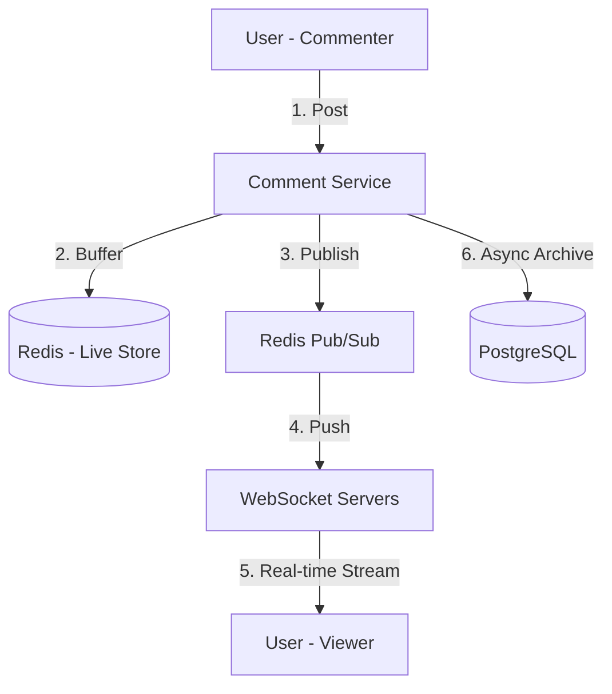

# Problem Breakdown: Designing FB Live Comments (Ultimate Guide)

Live Comments (like Facebook Live or Twitch) present a massive "Read/Write" challenge. When a celebrity goes live, 1 million people might be watching, with thousands of comments being posted per second. The core challenge is delivering these comments in real-time to all spectators without crashing the system or burying the most important ones.

---

## 1. Requirements

### Functional Requirements
- **Post Comment**: Users can post comments on a live video.
- **Real-time Display**: All viewers see a "Rolling Stream" of new comments.
- **Moderation**: Auto-filter spam and toxic content.
- **Upvoting/Highlights**: Important or popular comments stay longer.

### Non-Functional Requirements
- **Ultra-Low Latency**: Comments should appear in < 200ms.
- **High Availability**: Scaling to 1M+ concurrent viewers per video.
- **Eventually Consistent**: It's okay if two users see comments in a slightly different order, but everyone should feel the "Live" vibe.
- **Resilience**: The comment system shouldn't take down the video stream.

---

## 2. Estimation and Constraints

Assuming **1M Concurrent Viewers** for a Viral Video:
- **Write RPS**: 5,000 comments/sec.
- **Read/Fan-out**: 1M users * 10 comments/sec = **10 Million updates/sec**.
- This is a classic "Fan-out" problem on steroids.

---

## 3. Data Model Design

### Core Entities
- **Stream**: `stream_id, host_id, start_time`
- **Comment**: `comment_id, stream_id, user_id, text, timestamp, upvote_count`

### Database Selection
- **Relational (PostgreSQL)**: For archiving comments after the stream ends.
- **In-Memory (Redis)**: The primary engine for live comments. Redis's performance is $O(1)$ for list operations.
- **Pub/Sub (Redis Pub/Sub or Kafka)**: To distribute comments to WebSocket servers.

---

## 4. High-Level Design

---

## 5. Detailed Design: The Fan-out Optimization

If 1M people are watching, the WebSocket cluster can't push every single comment to everyone (bandwidth explosion).
- **Technique 1: Sampling**: For extremely popular streams, show only 10% of new comments to any given user. This preserves the "Live Feel" without wasting bandwidth.
- **Technique 2: Prioritized Buffering**: Group comments into small batches (e.g., every 500ms) and send them as a single packet.
- **Technique 3: Regional Sharding**: Fan-out comments locally within data centers to reduce cross-region traffic.

---

## 6. Real-time Moderation

We can't have a human moderate 5,000 comments/sec.
- **Solution**: Use an **Async Moderation Pipeline**.
- When a comment is posted, it hits a **Redis-based Spam Filter** (Rate limiter + Blacklist) and an **ML Filtering Service** (Sentiment analysis).
- If flagged, it's immediately hidden or marked for deletion in the Redis Live Store and Pub/Sub stream.

---

## 7. Scaling the WebSocket Cluster

1M viewers require ~1,000 WebSocket servers (assuming 1,000 connections/server). 
- **The Delivery Problem**: How do all 1,000 servers know about the new comment?
- **Broker Pattern**: Use a **Redis Cluster** or **NATS** as a message broker. Each WebSocket server subscribes to `stream:{stream_id}`. When the Comment Service publishes to this topic, all 1,000 servers receive it and push to their local users.

---

## 8. Identifying & Resolving Bottlenecks

- **Comment Throttling**: In a massive stream, comments scroll so fast that they are unreadable.
    - **Fix**: The client app should limit the display rate (e.g., max 5 per second). The server can also prioritize comments from "Friends" or "Top Fans" in the fan-out logic.
- **Persistence Lag**: Archiving millions of comments to Postgres can be slow.
    - **Fix**: Use **Bulk Inserts**. Collect 1,000 comments and do a single multi-row insert.
- **Redis Memory**: A 2-hour stream with 5k comments/sec could take GiBs.
    - **Fix**: Use a **TTL (Time To Live)** on live comments. Once they scroll off the screen and are archived, delete them from the "Hot" Redis store.

> **Senior Tip**: Mention **Backpressure**. If a WebSocket server is lagging behind, it should drop the oldest comments in its buffer to catch up to the "Now". Showing "Old" live comments is confusing for the user.
