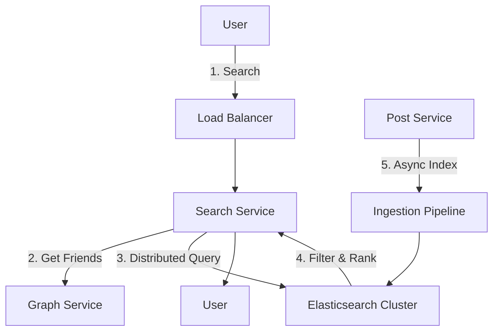

# Problem Breakdown: Designing FB Post Search (Ultimate Guide)

Searching through trillions of posts from billions of users is one of the hardest search challenges. Unlike Google (which searches a public web), FB Search is "Social" and "Private," meaning visibility depends on who is searching.

---

## 1. Requirements

### Functional Requirements
- **Search Posts**: Find posts containing specific keywords.
- **Filtering**: Filter by date, location, or author.
- **Social Ranking**: Prioritize posts from friends and groups the user belongs to.
- **Privacy**: Only show posts the user is authorized to see.

### Non-Functional Requirements
- **Low Latency**: Search results in < 300ms.
- **High Scalability**: Indexing millions of new posts per second.
- **Relevance**: Social relevance is more important than exact keyword matching.
- **Update Freshness**: New posts should be searchable within minutes.

---

## 2. Estimation and Constraints

Assuming **2B Users** and **Trillions of Posts**:
- **Write RPS**: 100k posts/sec.
- **Read RPS**: 10k searches/sec.
- **Data Size**: PBs of data. This cannot fit in a single search index.

---

## 3. Data Model Design

### Core Entities
- **Post**: `post_id, author_id, text, timestamp, privacy_setting (Public/Friends/Private)`
- **User_Graph**: `user_id, friend_list, group_list`

### Database Selection
- **Search Engine (Elasticsearch / Lucene)**: The industry standard for full-text search.
- **In-Memory Graph (Facebook's Tao)**: To quickly determine social distance during ranking.
- **NoSQL (HBase/Cassandra)**: The source of truth for raw post content.

---

## 4. High-Level Design

---

## 5. Detailed Design: The Indexing Strategy

We cannot have one giant index. We must shard.
- **Option A: Shard by PostID**: Good for write balance, but Every Search must hit Every Shard. $O(N)$ shards.
- **Option B: Shard by UserID**: Great for privacy and social search. If I'm searching for my own posts, I only hit my shard.
- **Facebook's Approach**: A hybrid. Use a **Document-based partitioned index** (PostID) for global search and a **User-based secondary index** for social filters.

---

## 6. Social Relevance & Ranking

Ranking is the "Secret Sauce."
1. **Keyword Match**: Classic TF-IDF or BM25 score.
2. **Feature Injection**:
    - **Freshness**: Newer is better.
    - **Social Proximity**: User A is a friend of User B (+100 score).
    - **Engagement**: Post has 1,000 likes (+50 score).
3. **Execution**: The search engine returns 1,000 matches. A separate **Ranking Service** re-orders the top 100 using a lightweight ML model.

---

## 7. The Privacy Filter

Privacy must be applied at the **Retrieval Level**, not the display level.
- **Problem**: If we return 20 posts and then filter out 15 because of privacy, the user only sees 5 results.
- **Solution**: The search query includes privacy metadata. Each document in the index contains an `access_list` or `privacy_type`. The search engine only considers documents where `(privacy == PUBLIC) OR (author_id IN [FriendList])`.

---

## 8. Identifying & Resolving Bottlenecks

- **The Delete Problem**: Users delete posts frequently. Deleting from a search index is expensive (Lucene segments are immutable).
    - **Fix**: Use a **Tombstone Bitset**. Mark the document as deleted in memory. The search engine skips it during the scan. It is physically removed during the next "Segment Merge."
- **NRT (Near Real-Time) Indexing**: Waiting for 5-minute batch jobs is too slow for social media.
    - **Fix**: Use a **Two-Tier Index**.
        1. **Small Buffer Index**: In-memory, updated instantly for the last 10 minutes of posts.
        2. **Main Index**: Disk-based, updated via batch merges every few minutes.
- **Query Expansion**: If a user searches "Coding," also search for "Programming" and "Software." Use a **Synonym Map** in Elasticsearch.

> **Senior Tip**: Mention **Multi-tenancy**. For massive scale, you might have different index clusters for "Top Posts," "News Posts," and "Marketplace Posts." This isolates noisy tenants and allows for different ranking algorithms per use-case.
