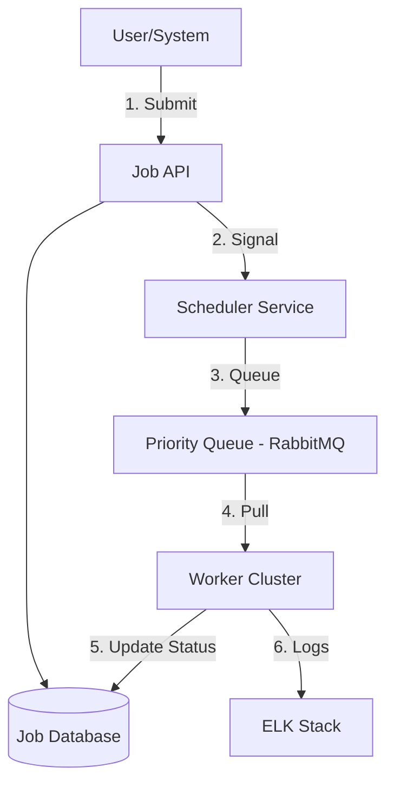

# Problem Breakdown: Designing a Distributed Job Scheduler (Ultimate Guide)

A distributed job scheduler (like Airflow, Celery, or Temporal) manages the execution of background tasks. The primary challenges are ensuring high reliability (no jobs lost), handling varying task durations, and scaling to millions of concurrent executors.

---

## 1. Requirements

### Functional Requirements
- **Schedule Jobs**: Create one-time or recurring (Cron) jobs.
- **Job Execution**: Route jobs to available workers.
- **Status Tracking**: Monitor job lifecycle (Pending, Running, Success, Failed).
- **Retries**: Automatically retry failed jobs with exponential backoff.
- **Priority**: High-priority jobs (e.g., Password Reset Email) should jump the queue.

### Non-Functional Requirements
- **Reliability**: Jobs must be durable. If a worker dies, the job must be reassigned.
- **Scalability**: Handle millions of jobs across thousands of workers.
- **Observability**: Provide logs and metrics for every job execution.
- **No Double-Execution**: For critical tasks, ensure a job is processed at-most-once or is idempotent.

---

## 2. Estimation and Constraints

Assuming **10 Million Jobs Per Day**:
- **RPS**: ~120 jobs/sec (average).
- **Concurrency**: If an average job takes 10s, we have **1,200 active concurrent jobs**.
- **Storage**: 10M jobs * 1KB metadata = **10 GB/day**.

---

## 3. Data Model Design

### Core Entities
- **Job_Definition**: `job_id, command, schedule (Cron), priority, timeout`
- **Job_Instance**: `instance_id, job_id, status, worker_id, start_time, end_time, retry_count`

### Database Selection
- **Relational (PostgreSQL)**: Ideal for maintaining state transitions with high consistency.
- **Message Queue (RabbitMQ / SQS)**: To decouple the "Scheduler" (producer) from the "Workers" (consumers).
- **Key-Value Store (Redis)**: For fast worker heartbeats and distributed locking.

---

## 4. High-Level Design

---

## 5. Detailed Design: Reliability & Retries

### A. The "Visibility Timeout" (At-Least-Once Delivery)
If Worker A pulls a job but crashes immediately:
1. The message remains "In Flight" in the queue.
2. If Worker A doesn't send an **ACK** within the timeout (e.g., 30s), the queue makes the message visible again.
3. Worker B pulls the job and executes it.

### B. Durable Execution (The Temporal/Saga Pattern)
For complex, multi-step workflows (e.g., "Charge Card -> Send Email -> Ship Order"):
- Instead of simple queues, use **Event Sourcing**.
- The system records every completed step in a "History Log."
- If the workflow stops, the next worker "replays" the history and resumes exactly where the previous one left off.

---

## 6. Priority Queues

Standard queues are FIFO. To support priority:
- **Approach 1**: Multiple queues (High, Medium, Low). Workers check High first.
- **Approach 2**: A single **Redis Sorted Set** (`ZSET`) where `Priority` score determines the order.

---

## 7. Scaling the Scheduler (Leader Election)

We cannot have 5 Schedulers polling the DB simultaneously, or they will double-schedule.
- **Solution**: **Active-Passive High Availability**.
- Use **Zookeeper or Consul** to elect one "Leader" Scheduler.
- Only the Leader is allowed to poll the `Job_Definition` table and push messages to the queue.
- If the Leader dies, a "Follower" is promoted within seconds.

---

## 8. Identifying & Resolving Bottlenecks

- **Worker Starvation**: If long-running jobs (batch processing) clog all workers, short jobs (API triggers) will wait.
    - **Fix**: **Resource Isolation**. Dedicate specific workers to the "Fast Queue" and others to the "Slow Queue".
- **Database Indexing**: The `NEXT_TO_RUN` query (`SELECT * FROM jobs WHERE status = 'PENDING' AND run_at < NOW()`) must be ultra-fast. Use a **Partial Index** on `status` and `run_at`.
- **Throttling/Backpressure**: If the queue has 1M messages, tell the API to return a 429 to the user to prevent system collapse.

> **Senior Tip**: Mention **Idempotency**. Since we use "At-least-once" delivery, jobs *will* be executed twice eventually. Every job should have a unique `business_key` (e.g., `order_id`) that the worker checks before performing the action.
