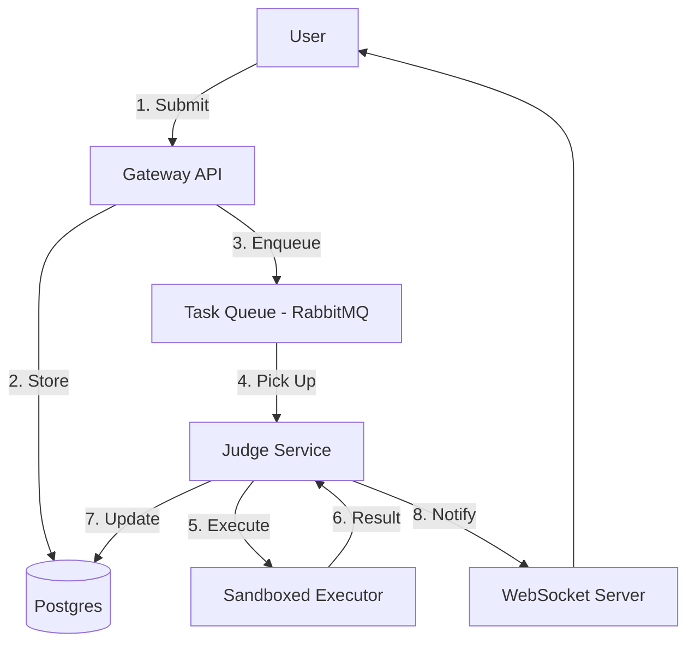

# Problem Breakdown: Designing LeetCode (Online Judge)

An Online Judge system (like LeetCode or HackerRank) allows users to submit code, which is then executed against hidden test cases. The primary challenges are securely executing untrusted code, managing a pool of isolated execution environments, and providing real-time feedback.

---

## 1. Requirements

### Functional Requirements
- **Code Submission**: Support multiple languages (Python, Java, C++).
- **Code Execution**: Run code against test cases.
- **Judging**: Compare output with expected result (Pass/Fail/TLE/MLE).
- **Results**: Real-time feedback to the user.
- **Leaderboard**: Rank users based on execution time and memory.

### Non-Functional Requirements
- **Security**: Prevent code from accessing the host network, file system, or other users' data.
- **Isolation**: One user's code should not affect another's performance.
- **High Availability**: Submissions should not be lost.
- **Low Latency**: Users want results in seconds.

---

## 2. Estimation and Constraints

Assuming **100,000 Submissions Per Day**:
- **Peak Traffic**: 10 submissions/sec.
- **Execution Time**: Average 1-2 seconds per submission.
- **Workers**: We need ~20-50 concurrent execution environments to keep wait times low.

---

## 3. Data Model Design

### Core Entities
- **Problem**: `problem_id, title, description, time_limit, memory_limit`
- **Test_Case**: `case_id, problem_id, input_data, expected_output`
- **Submission**: `submission_id, user_id, problem_id, code_content, language, status (PENDING, RUNNING, COMPLETED)`
- **Result**: `submission_id, status (AC, TLE, MLE, WA), exec_time, memory_usage`

### Database Selection
- **Relational (PostgreSQL)**: To store user history, problem statements, and metadata.
- **Blob Store (S3)**: For large test cases (input/output files).
- **NoSQL (Redis)**: To store real-time submission status for the frontend.

---

## 4. High-Level Design

---

## 5. Detailed Design: The Sandboxed Executor

This is the most critical part of the system for security.
- **Option 1: Docker Containers**: Easy to spin up, but "heavy" and can have escape vulnerabilities if not hardened.
- **Option 2: nsjail / gVisor**: Google-developed tools for Linux process isolation. They restrict system calls (seccomp), limit resources (cgroups), and use a temporary filesystem.
- **Workflow**:
    1. Worker pulls code and test data.
    2. Mounts the code as a read-only volume into a fresh sandbox.
    3. Executes the code with a hard **Time Limit (SIGXCPU)** and **Memory Limit**.
    4. Captures the `stdout` and compares it to the expected file.

---

## 6. Real-time Feedback

Since code execution can take seconds, we shouldn't keep the HTTP request open.
1. Return `submission_id` immediately.
2. The client opens a **WebSocket** connection or starts **polling** an endpoint.
3. When the Judge Service finishes, it updates Redis.
4. The WebSocket server sees the update and pushes "PASSED" or "TLE" to the user.

---

## 7. Handling Common Failures

- **Infinite Loops**: The sandbox must have a hard CPU time limit (e.g., 2s). The OS will send a `SIGKILL` if it exceeds this.
- **Memory Hogs**: Cgroups (Control Groups) in Linux will kill the process if it goes over the memory limit (e.g., 256MB).
- **Fork Bombs**: Set `nproc` limits to prevent the code from spawning thousands of threads/processes.

---

## 8. Identifying & Resolving Bottlenecks

- **Test Case Bloat**: If a problem has 100 test cases, downloading them for every submission is slow.
    - **Fix**: Cache test cases on the Worker's local SSD.
- **Cold Boot Latency**: Spinning up a fresh Docker container for every submission takes ~500ms.
    - **Fix**: **Pre-warmed Pool**. Keep a pool of "Warm" containers for each popular language (Python, Java) ready to receive code via an RPC call.
- **Queue Backup**: During a contest, 50k people might submit at once.
    - **Fix**: **Priority Queueing**. Paid users or contest participants get their jobs picked up first.

> **Senior Tip**: Mention **Judge Result Consistency**. Code might run slightly faster or slower based on the worker's CPU temperature or noisy neighbors. To be fair, some systems run the code 3 times and take the average, or Use **Static Analysis** (counting instructions) instead of wall-clock time for truly deterministic results.
