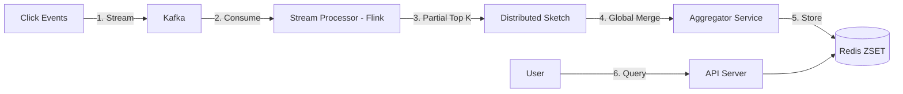

# Problem Breakdown: Designing Top K / Heavy Hitters (Ultimate Guide)

The "Top K" problem (e.g., YouTube's most viewed videos in the last hour) is a classic scalability challenge. When you have billions of events, you cannot store a counter for every single item in memory. The core challenge is efficiently identifying the most popular items using sub-linear space.

---

## 1. Requirements

### Functional Requirements
- **Track Events**: Monitor billion of events (e.g., video views, search queries).
- **Identify Top K**: Return the top K items (e.g., K=100) for a given time window (e.g., last 1 minute, 1 hour).
- **Global Scale**: Work across multiple data centers.

### Non-Functional Requirements
- **Low Latency**: Top K results should be available in sub-second.
- **High Throughput**: Handle millions of events per second.
- **Approximate Accuracy**: Minor error margin (e.g., 0.1%) is acceptable for extreme scale.
- **Memory Efficiency**: Use a fixed amount of memory regardless of the number of unique items.

---

## 2. Core Concepts: Probabilistic Data Structures

### A. Count-Min Sketch
A 2D array of counters with multiple hash functions.
- **Upside**: $O(1)$ updates and constant memory.
- **Downside**: Over-estimates counts due to hash collisions. Excellent for "Is this item a heavy hitter?" but not for exact counts.

### B. Space-Saving Algorithm
Maintains a fixed-size list of `(Item, Count)` pairs.
- If a new item is seen:
    - If it's in the list, increment count.
    - If not, replace the item with the lowest count and increment it.
- **Pro**: Very accurate for the most popular items.

---

## 3. High-Level Design

---

## 4. Detailed Design: The Two-Stage Aggregation

To avoid a single bottleneck, we aggregate in two levels:

1. **Local Aggregation (Tier 1)**:
    - Every Top-K worker processes a shard of the Kafka stream.
    - It maintains a local **Count-Min Sketch** or **Space-Saving** list for 1 minute.
2. **Global Aggregation (Tier 2)**:
    - Every minute, workers send their Top 1000 items to a central **Aggregator Service**.
    - The Aggregator merges these lists to form the final "Global Top K".

---

## 5. Handling Data Skew

In a "Heavy Hitter" scenario, 1% of the items (e.g., a viral video) might account for 90% of the traffic.
- **Fix**: Use **Hash-based Partitioning** in Kafka to ensure all events for one video go to the same worker. If one worker is overwhelmed, split the heavy hitter's traffic across multiple "Sub-shards" and merge them in Tier 2.

---

## 6. Time Windows

How do we handle the "Last Hour" vs "Last 24 Hours"?
- **Tumbling Windows**: Non-overlapping (e.g., 12:00-1:00).
- **Sliding Windows**: Overlapping (e.g., 12:01-1:01).
- **Solution**: Store counts in **1-minute buckets** in a time-series DB or Redis. To get the "Last hour", sum up 60 buckets.

---

## 7. Scaling & Persistence

- **Redis Sorted Sets (ZSET)**: The perfect structure for the final output. `ZREVRANGE` returns the Top K in $O(\log N + K)$.
- **Checkpointing**: Workers must save their sketch state to S3/HDFS. If a worker fails, it reloads the sketch and continues from the last Kafka offset.

---

## 8. Identifying & Resolving Bottlenecks

- **Accuracy Loss**: If many items have similar counts, Count-Min Sketch will fail.
    - **Fix**: Use a larger sketch or the **HeavyKeeper** algorithm, which uses a "decay" strategy to keep only the most frequent items.
- **Network Overhead**: Sending thousands of partial lists to the Aggregator every minute.
    - **Fix**: Use **Frequency Thresholding**. Only send items to the global aggregator if their local count is above a certain percentage of the local total.

> **Senior Tip**: Mention **Log-log / HyperLogLog**. If the requirement is "Unique Viewers" instead of total views, you must combine your Top-K strategy with **HyperLogLog** to count unique IDs with minimal memory.
