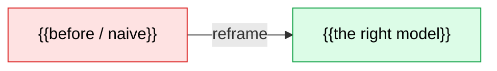

<!--
═══════════════════════════════════════════════════════════════════════════
  CANONICAL TOPIC TEMPLATE  —  copy this file when authoring a new topic.
  Every deep-dive note in this repo follows this structure so the whole
  series reads consistently. Delete these HTML comments in the real file.

  HOW TO USE
  1. Copy TEMPLATE.md → <Section>/<Your_Topic>.md
  2. Replace every {{PLACEHOLDER}}.
  3. Keep the section ORDER and the three "mastery" sections at the end.
  4. Put SVGs in /assets (repo root) and link with a RELATIVE path:
        
     where <prefix> is a short topic tag (boe_, qps_, cap_, cost_, …).
  5. Use markdown links for ALL file/code references, never backticks:
        [filename.md](./filename.md)   ·   [src/x.ts:42](../path#L42)

  CONVENTIONS
  • Title hook: a single ">" blockquote, one sentence, plain-English.
  • Mermaid: prefer flowchart / sequenceDiagram / mindmap. Give nodes a
    fill via `style X fill:#dcfce7,color:#000` so they read in light & dark.
    Palette used across the repo:
        green  #dcfce7 / #34d399   (good / chosen / fast)
        red    #fee2e2 / #f87171   (bad / failure / slow)
        amber  #fef3c7 / #fbbf24   (caution / the result / cost)
        blue   #e0f2fe / #60a5fa   (neutral / consistency)
        purple #ede9fe / #818cf8   (start / input)
  • Animated SVGs: self-contained, use SMIL <animate> + CSS <style>.
    NO <script> (sanitizers strip it). NO duplicate attributes (e.g. two
    `class="…"` on one element — strict XML parsers reject the file).
  • Drill solutions go inside <details><summary>Solution</summary>…</details>.
  • End every file with a one-paragraph TL;DR.

  NUMBERING
  • Sections 1..N are numbered. The three mastery sections use emoji headers
    (unnumbered) and sit just before "Connections". Keep the TOC in sync.
═══════════════════════════════════════════════════════════════════════════
-->

# {{Topic Title}}

> **One line:** {{A single plain-English sentence a smart beginner understands — the "why this exists" hook.}}

---

## Table of Contents
1. [Why You Must Master This](#1-why-you-must-master-this)
2. [The Mental Model](#2-the-mental-model)
3. [{{Core Concept A}}](#3-core-concept-a)
4. [{{Core Concept B}}](#4-core-concept-b)
5. [{{… add as many core sections as the topic needs …}}](#5-)
6. [Worked Example — {{name}}](#6-worked-example--name)
7. [Real-Life Use Cases](#7-real-life-use-cases)
8. [Failure Modes](#8-failure-modes)
9. [🏋️ Practice Drills](#-practice-drills)
10. [🎤 Interview Q&A Bank](#-interview-qa-bank)
11. [🎯 Staff+ Nuances](#-staff-nuances)
12. [Cheat Sheet](#12-cheat-sheet)
13. [Connections & Further Reading](#13-connections--further-reading)

---

## 1. Why You Must Master This

{{2–4 bullets on the real stakes — what breaks without this, what it unlocks. Bold the lead phrase of each bullet.}}

> **The core problem it solves:** {{the one-line problem statement.}}

---

## 2. The Mental Model

{{The intuition first — an analogy a non-expert gets. Follow with a mermaid diagram that captures the core idea.}}



---

## 3. {{Core Concept A}}

{{Deep explanation. Use tables for comparisons, code fences for concrete examples, and at least one mermaid diagram or an animated SVG.}}


---

## 4. {{Core Concept B}}

{{… continue with as many numbered core sections as the topic genuinely needs (typically 4–8 total). Each should teach ONE idea well.}}

---

## 6. Worked Example — {{name}}

{{A concrete, numbers-driven walkthrough. A mermaid sequence/flowchart showing how the concept drives a real decision. Always close the loop: number → architectural consequence.}}

---

## 7. Real-Life Use Cases

{{A table mapping real situations → how this concept decides the outcome. "This isn't just interviews."}}

| Situation | How {{topic}} applies |
|-----------|------------------------|
| {{…}} | {{…}} |

> {{One-line "real-world habit" the reader should adopt.}}

---

## 8. Failure Modes

```mermaid
mindmap
  root(({{Topic}} Pitfalls))
    {{Pitfall 1}}
      {{detail}}
    {{Pitfall 2}}
      {{detail}}
```

{{Bullet each failure mode with the symptom and the fix.}}

---

## 🏋️ Practice Drills

> *Cover the solutions and attempt first — active recall is the point.*

**Drill 1 — {{title}}.** {{problem}}

<details><summary>Solution</summary>

{{worked solution}}
</details>

**Drill 2 — {{title}}.** {{problem}}

<details><summary>Solution</summary>

{{worked solution}}
</details>

{{3–4 drills total.}}

---

## 🎤 Interview Q&A Bank

**Q1. {{question}}**
> {{model answer — concise, confident, with the reasoning.}}

**Q2. {{question}}**
> {{model answer.}}

{{6–8 questions. Where useful, note "(signal: …)" — what the question tests.}}

---

## 🎯 Staff+ Nuances

{{5–7 bullets of advanced, non-obvious depth: edge cases, what senior+ engineers debate, common expert mistakes, and forward references with [[links]] to related topics.}}

- **{{Nuance lead}}.** {{explanation, linking to [related topic](./Related.md) where relevant.}}

---

## 12. Cheat Sheet

```
{{A dense, printable ASCII quick-reference: key formulas, numbers,
  rules of thumb, and the do/don't list. This is the "night before
  the interview" page.}}
```

---

## 13. Connections & Further Reading

**Within this repo:**
- [{{Related_File.md}}](./{{Related_File.md}}) — {{why it connects}}.
- [{{Section}}](../{{NN_Section}}/) — {{where this leads}}.

**External classics:**
- *{{Book / paper}}* ({{author}}) — {{what it covers}}.

---

## TL;DR
{{One tight paragraph: the whole topic distilled. Lead with the single most important takeaway, then the 2–3 supporting rules. Bold the imperative the reader should remember.}}
