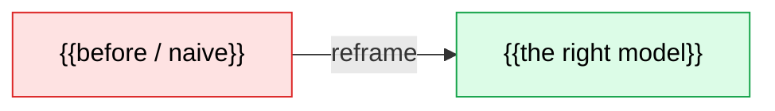
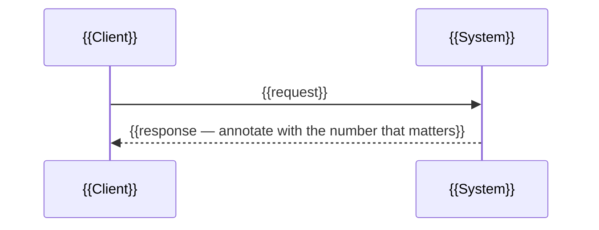

<!--
═══════════════════════════════════════════════════════════════════════════
  CANONICAL TOPIC TEMPLATE  —  copy this file when authoring a new topic.
  Every deep-dive note in this repo follows this structure so the whole
  series reads consistently. Delete these HTML comments in the real file.

  ───────────────────────────────────────────────────────────────────────
  THE GOAL (read this first — it changes how you write everything below)
  ───────────────────────────────────────────────────────────────────────
  Each finished file must be a SINGLE SOURCE OF TRUTH for its topic.
  The reader should be able to close every other tab — no blog, no docs,
  no YouTube — study this one file, and walk into a Staff+ system-design
  interview (or a real architecture review) genuinely EXPERT on it.

  That bar has three consequences for how you write:

  1. DEPTH OVER SUMMARY. Do not define-and-move-on. For every core idea
     teach: (a) what it is, (b) WHY it exists / what breaks without it,
     (c) HOW it actually works under the hood — the mechanism, not the
     label, (d) the trade-off and when the OTHER choice wins, (e) a real
     number or a real system that uses it. If a smart reader could still
     ask "…but how does that actually work?", you stopped too early.

  2. VISUALS ARE MANDATORY, NOT DECORATION. See the VISUALS POLICY below.
     A concept that is spatial, temporal, comparative, or has moving parts
     MUST have a diagram. Prefer showing over telling.

  3. NAME THE GAPS. A single source of truth also tells the reader what
     ELSE they must learn. Every file ends by pointing outward (see the
     Connections section), and every SECTION carries a gap analysis in its
     README (see "SECTION GAP ANALYSIS" below).

  ───────────────────────────────────────────────────────────────────────
  HOW TO USE (author workflow)
  ───────────────────────────────────────────────────────────────────────
  1. Copy TEMPLATE.md → <Section>/<Your_Topic>.md
  2. Replace every {{PLACEHOLDER}}. Delete guidance you have satisfied.
  3. Keep the section ORDER and the three "mastery" sections at the end.
  4. DEPTH PASS — reread each core section and ask the five DEPTH-OVER-
     SUMMARY questions above. Fill every hole before moving on.
  5. VISUALS PASS — walk the file top to bottom. Wherever a paragraph
     describes structure, flow, timing, or a comparison and has NO figure,
     add one (mermaid inline, or an SVG in /assets). Aim for a visual every
     screenful or two — never a wall of prose.
  6. SECTION GAP ANALYSIS — after (or while) authoring, evaluate the whole
     section for completeness and record the result in the section README
     (see the dedicated block below). This is how "missing topics" get
     surfaced instead of silently omitted.
  7. Put SVGs in /assets (repo root) and link with a RELATIVE path:
        
     where <prefix> is a short topic tag (boe_, qps_, cap_, cost_, …).
  8. Use markdown links for ALL file/code references, never backticks:
        [filename.md](./filename.md)   ·   [src/x.ts:42](../path#L42)

  ───────────────────────────────────────────────────────────────────────
  VISUALS POLICY  (the "add SVGs wherever needed" rule, made concrete)
  ───────────────────────────────────────────────────────────────────────
  Default to a visual. Text explains; a picture makes it stick. Add one
  whenever ANY of these is true — do not wait to be told:
    • Structure    — components, layers, a topology, who-talks-to-whom.
    • Flow / time  — a request path, a sequence, a state transition, a
                     before→after, a retry/failure timeline.
    • Comparison   — A vs B, a spectrum, a quadrant, a trade-off curve.
    • Quantity     — a magnitude ladder, a latency scale, a cost stack,
                     a growth/scaling curve. Numbers land harder as a bar.
    • Decision     — "which do I pick?" → a decision tree / flowchart.

  Pick the right medium:
    • mermaid (inline)  — flowchart, sequenceDiagram, stateDiagram, mindmap,
      quadrantChart, gantt. Use for logic/flow you want version-controlled
      and easy to edit. This is the DEFAULT — reach for it first.
    • SVG in /assets    — when you need precise layout, a custom illustration,
      an annotated diagram, a chart with exact proportions, or ANIMATION
      (a packet moving, a cache filling, a partition healing). Animation is
      worth it when *motion is the point*; otherwise a static mermaid wins.
    • Table             — when the comparison is discrete and cell-by-cell.
      A table IS a visual; use it for feature matrices and "when to use X".

  Every figure needs (a) real alt text, and (b) a one-line caption or lead
  sentence stating the ONE thing the reader should take from it. A diagram
  with no takeaway is noise.

  ───────────────────────────────────────────────────────────────────────
  SECTION GAP ANALYSIS  (do this per SECTION, record in the section README)
  ───────────────────────────────────────────────────────────────────────
  A section is only a source of truth if it is COMPLETE. After analysing
  the topics a section already has, judge what a true expert on this area
  would also need — then add a short table to the section's README.md:

      ## 🧩 Gap Analysis — What Else Belongs Here
      | Candidate topic | Why it matters | Priority | Status |
      |-----------------|----------------|----------|--------|
      | {{topic}}       | {{the gap it fills / when it comes up}} | High/Med/Low | ✅ have · ➕ add · 🔗 lives in NN |

    • List topics that are MISSING (not yet written) and topics that are
      UNDER-COVERED (mentioned but deserve their own file).
    • Rank by how often they decide a real design or come up in interviews.
    • If a topic really belongs to another section, say where (🔗) instead
      of duplicating it — the goal is one home per idea, cross-linked.
    • Revisit this table whenever you add a file so it stays honest.
  This is where "the topics that need to be added" get captured.

  ───────────────────────────────────────────────────────────────────────
  CONVENTIONS
  ───────────────────────────────────────────────────────────────────────
  • Title hook: a single ">" blockquote, one sentence, plain-English.
  • Mermaid: prefer flowchart / sequenceDiagram / stateDiagram / mindmap /
    quadrantChart. Give nodes a fill via `style X fill:#dcfce7,color:#000`
    so they read in light & dark. Palette used across the repo:
        green  #dcfce7 / #34d399   (good / chosen / fast)
        red    #fee2e2 / #f87171   (bad / failure / slow)
        amber  #fef3c7 / #fbbf24   (caution / the result / cost)
        blue   #e0f2fe / #60a5fa   (neutral / consistency)
        purple #ede9fe / #818cf8   (start / input)
  • Animated SVGs: self-contained, use SMIL <animate> + CSS <style>.
    NO <script> (sanitizers strip it). NO duplicate attributes (e.g. two
    `class="…"` on one element — strict XML parsers reject the file).
  • Numbers: prefer concrete, sourced figures (latencies, QPS, $/GB, real
    system limits) over "fast" / "a lot". A number the reader can quote in
    an interview is worth a paragraph of adjectives.
  • Drill solutions go inside <details><summary>Solution</summary>…</details>.
  • End every file with a one-paragraph TL;DR.

  ───────────────────────────────────────────────────────────────────────
  NUMBERING
  ───────────────────────────────────────────────────────────────────────
  • Sections 1..N are numbered. The three mastery sections use emoji headers
    (unnumbered) and sit just before "Connections". Keep the TOC in sync.

  ───────────────────────────────────────────────────────────────────────
  AUTHOR CHECKLIST — a file is not done until every box is true
  ───────────────────────────────────────────────────────────────────────
  [ ] Every core concept answers the 5 depth questions (what/why/how/
      trade-off/real number).
  [ ] There is a visual within ~every 1–2 screenfuls; no long prose wall.
  [ ] Every figure has alt text + a one-line takeaway.
  [ ] Worked example closes the loop: a number → an architectural decision.
  [ ] Failure modes give SYMPTOM → ROOT CAUSE → FIX, not just names.
  [ ] Interview answers are speakable in ~30–60s and state the trade-off.
  [ ] Connections point to prerequisites AND next topics with [[links]].
  [ ] The section README's Gap Analysis table reflects this file.
  [ ] TL;DR leads with the single most important takeaway.
═══════════════════════════════════════════════════════════════════════════
-->

# {{Topic Title}}

> **One line:** {{A single plain-English sentence a smart beginner understands — the "why this exists" hook.}}

---

## Table of Contents
1. [Why You Must Master This](#1-why-you-must-master-this)
2. [The Mental Model](#2-the-mental-model)
3. [{{Core Concept A}}](#3-core-concept-a)
4. [{{Core Concept B}}](#4-core-concept-b)
5. [{{… add as many core sections as the topic needs …}}](#5-)
6. [Worked Example — {{name}}](#6-worked-example--name)
7. [Real-Life Use Cases](#7-real-life-use-cases)
8. [Failure Modes](#8-failure-modes)
9. [🏋️ Practice Drills](#-practice-drills)
10. [🎤 Interview Q&A Bank](#-interview-qa-bank)
11. [🎯 Staff+ Nuances](#-staff-nuances)
12. [Cheat Sheet](#12-cheat-sheet)
13. [Connections & Further Reading](#13-connections--further-reading)

---

## 1. Why You Must Master This

{{2–4 bullets on the real stakes — what breaks without this, what it unlocks. Bold the lead phrase of each bullet. Name a concrete incident-class or a real system where getting this wrong hurt.}}

> **The core problem it solves:** {{the one-line problem statement.}}

**Prerequisites:** {{1–2 topics the reader should already know, with [[links]]. This anchors where the topic sits in the learning path. Delete if truly standalone.}}

---

## 2. The Mental Model

{{The intuition first — an analogy a non-expert gets. Then the diagram: reframe the naive view into the right one. This diagram is required — the mental model is inherently a "before → after" comparison.}}



> **Hold onto this:** {{the one image/sentence that, if the reader forgets everything else, still gets them 80% right.}}

---

## 3. {{Core Concept A}}

{{DEEP explanation — hit all five depth beats:
   • what it is (precise definition, no hand-waving)
   • why it exists / what breaks without it
   • HOW it works under the hood — the actual mechanism, step by step
   • the trade-off, and the condition under which the OTHER choice wins
   • a real number or a real system that relies on it
 Use tables for comparisons and code fences for concrete examples.}}


> {{One-line takeaway from the figure above.}}

---

## 4. {{Core Concept B}}

{{… continue with as many numbered core sections as the topic genuinely needs (typically 4–8 total). Each teaches ONE idea to expert depth. Add a visual to any section that describes structure, flow, comparison, or quantity — that is most of them.}}

---

## 6. Worked Example — {{name}}

{{A concrete, numbers-driven walkthrough. Include a mermaid sequence/flowchart showing how the concept drives a real decision. Always close the loop: a specific NUMBER → the architectural CONSEQUENCE it forces. Show the arithmetic, don't assert the conclusion.}}



---

## 7. Real-Life Use Cases

{{A table mapping real situations → how this concept decides the outcome. "This isn't just interviews."}}

| Situation | How {{topic}} applies | The decision it forces |
|-----------|------------------------|------------------------|
| {{…}} | {{…}} | {{…}} |

> {{One-line "real-world habit" the reader should adopt.}}

---

## 8. Failure Modes

```mermaid
mindmap
  root(({{Topic}} Pitfalls))
    {{Pitfall 1}}
      {{detail}}
    {{Pitfall 2}}
      {{detail}}
```

{{For each failure mode give the full chain: SYMPTOM (what the reader observes) → ROOT CAUSE (why it happens) → FIX (what to do). A list of scary names with no cause/fix is not enough.}}

---

## 🏋️ Practice Drills

> *Cover the solutions and attempt first — active recall is the point.*

**Drill 1 — {{title}}.** {{problem}}

<details><summary>Solution</summary>

{{worked solution — show the reasoning, not just the answer}}
</details>

**Drill 2 — {{title}}.** {{problem}}

<details><summary>Solution</summary>

{{worked solution}}
</details>

{{3–4 drills total. Mix a recall drill, a calculation drill, and a "design a small thing" drill.}}

---

## 🎤 Interview Q&A Bank

**Q1. {{question}}**
> {{model answer — concise, confident, speakable in ~30–60s, and it names the trade-off.}}

**Q2. {{question}}**
> {{model answer.}}

{{6–8 questions. Where useful, note "(signal: …)" — what the question tests and what a strong vs weak answer sounds like.}}

---

## 🎯 Staff+ Nuances

{{5–7 bullets of advanced, non-obvious depth: edge cases, what senior+ engineers actually debate, common expert mistakes, and forward references with [[links]] to related topics. This is where the "single source of truth" earns the "expert" claim — put the stuff blogs skip here.}}

- **{{Nuance lead}}.** {{explanation, linking to [related topic](./Related.md) where relevant.}}

---

## 12. Cheat Sheet

```
{{A dense, printable ASCII quick-reference: key formulas, numbers,
  rules of thumb, and the do/don't list. This is the "night before
  the interview" page.}}
```

---

## 13. Connections & Further Reading

**Prerequisites (learn first):**
- [{{Foundational_File.md}}](./{{Foundational_File.md}}) — {{what you need from it}}.

**Builds toward / pairs with:**
- [{{Related_File.md}}](./{{Related_File.md}}) — {{why it connects}}.
- [{{Section}}](../{{NN_Section}}/) — {{where this leads}}.

**Gaps this topic exposes (candidates for the section's Gap Analysis):**
- {{a topic you found yourself wishing existed while writing this — feed it into the section README's Gap Analysis table.}}

**External classics:**
- *{{Book / paper}}* ({{author}}) — {{what it covers}}.

---

## TL;DR
{{One tight paragraph: the whole topic distilled. Lead with the single most important takeaway, then the 2–3 supporting rules. Bold the imperative the reader should remember.}}
